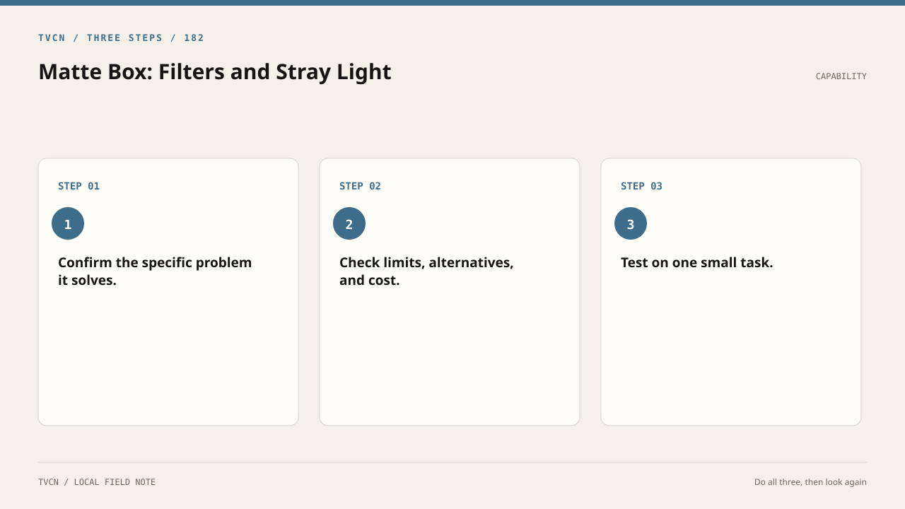

For light travel, wide lenses or fast lens changes, a matte box adds bulk and steps; use a lens hood and light filters. Do not trade mobility for “professional look.”

<!-- DIAGRAM_START -->
<h2>Diagram</h2>
<figure>
  
  <figcaption>Watch “Shoot black velvet in backlight and check the” and “Rotate the filter and check for vignetting.”; judge whether the spec maps to one concrete shooting problem.</figcaption>
</figure>
<!-- DIAGRAM_END -->
<section><h2 id="section-1">What to compare first</h2><ul><li><strong>Filter stages:</strong> how many slots, rotating polarizer and ND support; stage order affects vignetting.</li><li><strong>Diameter and shading:</strong> a deep matte box clips wide lenses; test the widest focal length first.</li><li><strong>Mount and light leaks:</strong> flags and top brow must lock; leaks show in long exposures and backlight.</li></ul><h2 id="section-2">When not to use it</h2></section><section><h2 id="section-3">On set</h2>
Shoot black velvet against the light and check for leaks at the matte box edge. Add a filter and rotate it to check vignetting.
</section><section><h2 id="section-4">Do this</h2>
A matte box blocks stray light before holding filters; a cheap one can leak and ruin the image.
<ol><li>Shoot black velvet in backlight and check the matte box edges for leaks.</li><li>Rotate the filter and check for vignetting.</li><li>Seal leaks with black cloth or tape.</li></ol></section><section><h2 id="section-5">Avoid</h2>
Do not treat a matte box as a filter holder; check leaks before loading filters.
</section>
<h2>Check</h2><ul><li>A backlit black velvet test shows whether edges leak.</li><li>Filter rotation logs where vignetting appears.</li><li>Leaks are sealed with black cloth or tape, not ignored.</li></ul>
