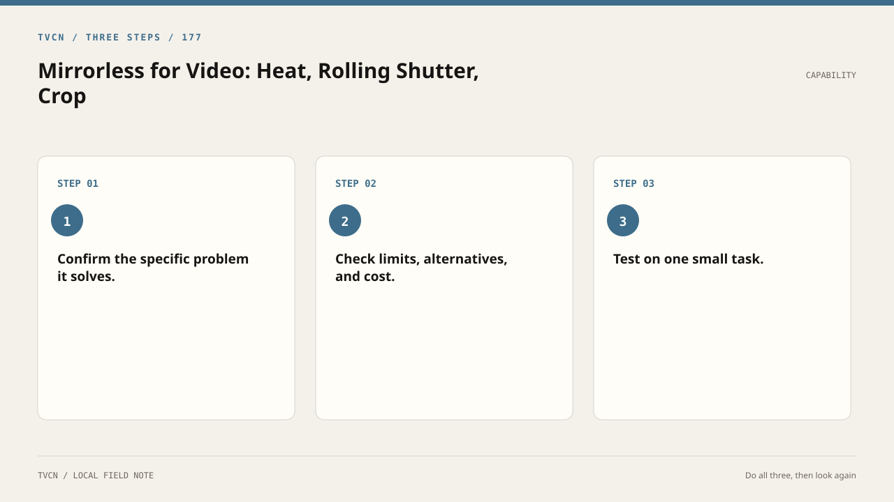

Check three things: overheating, rolling shutter, and whether video crops the frame.

<!-- DIAGRAM_START -->
<h2>Diagram</h2>
<figure>
  
  <figcaption>Do the three steps in order, then look again at the image or file.</figcaption>
</figure>
<!-- DIAGRAM_END -->
<h2>On set</h2>

Record thirty minutes of 4K 25p and watch for a heat warning. Pan across a railing for rolling shutter, then switch to 4K 60p and check the crop.

<h2>Do this</h2>

A mirrorless video camera must answer three things: overheating, rolling shutter, and crop in video mode.
<ol><li>Record thirty minutes of 4K 25p and watch for a heat warning.</li><li>Pan across a railing to see rolling shutter.</li><li>Switch to 4K 60p and check whether the angle narrows.</li></ol>
<h2>Avoid</h2>

Do not test for three minutes; overheating often appears around minute twenty.

<h2>Check</h2>
<ul><li>A thirty-minute 4K 25p run logs temperature or warnings.</li><li>Rolling shutter on the railing is visible and described.</li><li>The 4K 60p crop has a before-and-after angle comparison.</li></ul>
