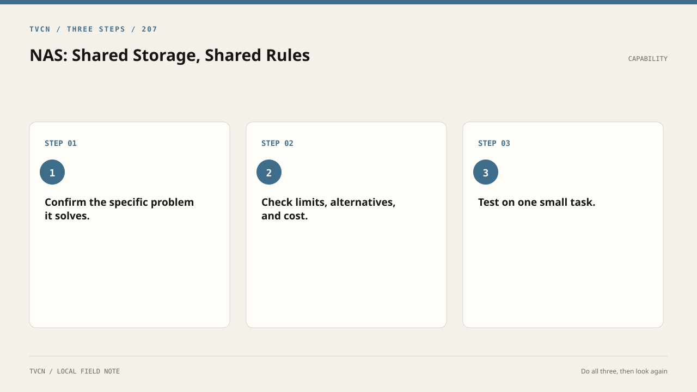

For one person and one project, power and management cost exceed a direct SSD. Do not buy complex storage early for a “team” feeling.

<!-- DIAGRAM_START -->
<h2>Diagram</h2>
<figure>
  
  <figcaption>Watch “Create user groups and read-only permissions.” and “Enable the recycle bin.”; judge whether the spec maps to one concrete shooting problem.</figcaption>
</figure>
<!-- DIAGRAM_END -->
<section><h2 id="section-1">What to compare first</h2><ul><li><strong>Bays and redundancy:</strong> at least two bays in mirror; a single-drive NAS is not backup, only a network disk.</li><li><strong>Network:</strong> gigabit is enough for a small team; multicam editing needs 2.5G/10G NICs, switches and cabling.</li><li><strong>Recovery:</strong> confirm rebuild after a failed drive and readability of old disks; RAID without a restore drill is reassurance only.</li></ul><h2 id="section-2">When not to use it</h2><h2 id="section-3">A NAS is a collaboration drive, not the only backup</h2>

A NAS solves sharing and versions, not fire, accidental deletion or ransomware. With a team NAS, add at least one offline drive and one offsite copy.

<ol><li>Permissions by project: editors read/write, clients read-only; remove departing staff the same day.</li><li>Enable snapshots for 7–30 days. Check a snapshot before deleting; do not empty the recycle bin first.</li><li>Use at least 2.5GbE for multi-track editing; gigabit is enough for proxies only.</li></ol>

Acceptance: restore last week's version from a snapshot; unplug the NAS and confirm an offline copy opens. Both must pass before you call it a backup.
</section><section><h2 id="section-4">On set</h2>
Create user groups, read-only permissions, and a recycle bin. Have two people write the same file and test the conflict warning.
</section><section><h2 id="section-5">Do this</h2>
NAS shares media across the team, but naming, permissions, and recycle rules come first; otherwise sharing means overwriting.
<ol><li>Create user groups and read-only permissions.</li><li>Enable the recycle bin.</li><li>Have two people write the same file and test the conflict warning.</li></ol></section><section><h2 id="section-6">Avoid</h2>
Do not give everyone read-write; two simultaneous edits erase a version.
</section>
<h2>Check</h2><ul><li>Groups and read-only permissions are set, not open write for all.</li><li>The recycle bin is on and deleted files are recoverable.</li><li>A two-writer test produces a conflict warning or lock.</li></ul>
