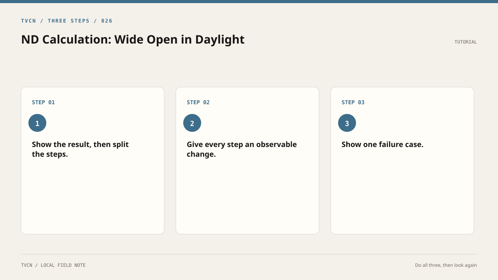

Set shutter and aperture, then calculate stops; guessing the filter leaves you dark nine times out of ten.

<!-- DIAGRAM_START -->
<h2>Diagram</h2>
<figure>
  
  <figcaption>Do the three steps in order, then look again at the image or file.</figcaption>
</figure>
<!-- DIAGRAM_END -->
<h2>On set</h2>

Set 1/50 and f/2.8, meter the scene EV, then calculate the stops to cut and choose the ND.

<h2>Do this</h2>

ND calculation fixes shutter and aperture first, then counts stops; guessing the filter is dark nine times out of ten.
<ol><li>Set 1/50 and f/2.8.</li><li>Meter ambient EV with a meter or the camera.</li><li>Calculate the stops needed and fit the matching ND.</li></ol>
<h2>Avoid</h2>

Do not swap ND by look; wrong stops put the face two stops under.

<h2>Check</h2>
<ul><li>Shutter 1/50 and aperture f/2.8 are locked first.</li><li>Ambient EV is metered, not estimated.</li><li>Calculated stops match the ND used and exposure lands on target.</li></ul>
