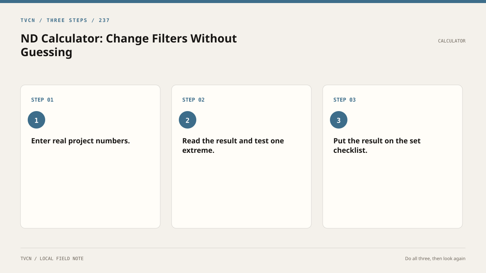

Fix aperture and ISO, then slow the shutter to the target; the needed reduction is ND stops = log2(current shutter ÷ target shutter) . From 1/50 to 1/200 is four times less light, so two stops.

<!-- DIAGRAM_START -->
<h2>Diagram</h2>
<figure>
  
  <figcaption>Watch “Enter 1/50, f/2.8, ISO 100.” and “Meter ambient EV.”; judge whether the spec maps to one concrete shooting problem.</figcaption>
</figure>
<!-- DIAGRAM_END -->
<section><h2 id="section-1">Formula and stops</h2>
Fix aperture and ISO, then slow the shutter to the target; the needed reduction is <strong>ND stops = log2(current shutter ÷ target shutter)</strong>. From 1/50 to 1/200 is four times less light, so two stops.
<ul><li>1 stop = 1/2 light, 2 stops = 1/4, 3 stops = 1/8, 10 stops = 1/1024.</li><li>Common markings: ND0.3≈1 stop, ND0.6≈2, ND0.9≈3, ND1.8≈6, ND3.0≈10.</li><li>Stacked filters add stops, not factors; two 3-stop filters equal 6 stops.</li></ul><h2 id="section-2">A worked example</h2>
On a sunny day you want f/2.8, 1/50, ISO 100 for shallow depth, but the meter says 1/1600 to avoid clipping: 1/1600 ÷ 1/50 = 32, log2(32)=5, so you need 5 stops. Fit ND1.5 (5 stops), return to 1/50, and exposure is back.
<h2 id="section-3">Limits</h2>
The formula only covers exposure, not color cast, vignetting or long-exposure heat noise. Shoot a test clip after changing the filter; do not trust the calculator alone.
</section><section><h2 id="section-4">On set</h2>
Enter 1/50, f/2.8, ISO 100 and meter the scene EV. Calculate the ND stops before changing filters.
</section><section><h2 id="section-5">Do this</h2>
An ND calculator puts shutter, aperture, ISO, and target exposure into one formula; calculate before changing the filter.
<ol><li>Enter 1/50, f/2.8, ISO 100.</li><li>Meter ambient EV.</li><li>Calculate ND stops, then fit the filter.</li></ol></section><section><h2 id="section-6">Avoid</h2>
Do not use defaults as the answer; they are not your project or light.
</section><section class="calc-widget" data-calculator="nd-calculator">
<h2 id="section-7">ND calculator</h2>

Enter current and target shutter denominators to get stops and the nearest standard ND.

<label class="calc-field">Current shutter denominator (1/s)<input type="number" inputmode="decimal" data-calc="current" data-default="50" value="50" step="1" min="1"></label><label class="calc-field">Target shutter denominator (1/s)<input type="number" inputmode="decimal" data-calc="target" data-default="25" value="25" step="1" min="1"></label>

<strong data-out="result">ND —</strong>Between two densities, pick less ND and trim with aperture.

<button type="button" data-reset>Reset defaults</button>

Formula: stops = log₂(current ÷ target); ND factor = 2^stops.

<noscript>
With JavaScript off, use the formula; 50 → 25 is about one stop, ND2.
</noscript>
</section><section>
<strong>Boundary</strong>

It does not replace an on-set reading. The number is a starting point; the monitor, scope or actual recording decides.
</section><section><h2>Alternative</h2>
If “Enter 1/50, f/2.8, ISO 100.” is not the main problem, start with the basic move behind “Meter ambient EV.”. Upgrade only after both hold.
</section><section><h2>60-second test</h2>
Run a 60-second test with the gear you own, focused on “Enter 1/50, f/2.8, ISO 100.”, and record one number. If the number does not change, do not add budget.
</section>
<h2>Check</h2><ul><li>Shutter, aperture, and ISO match the on-set settings.</li><li>Ambient EV is measured, not guessed.</li><li>Calculated ND stops match the filter and exposure lands on target.</li></ul>
