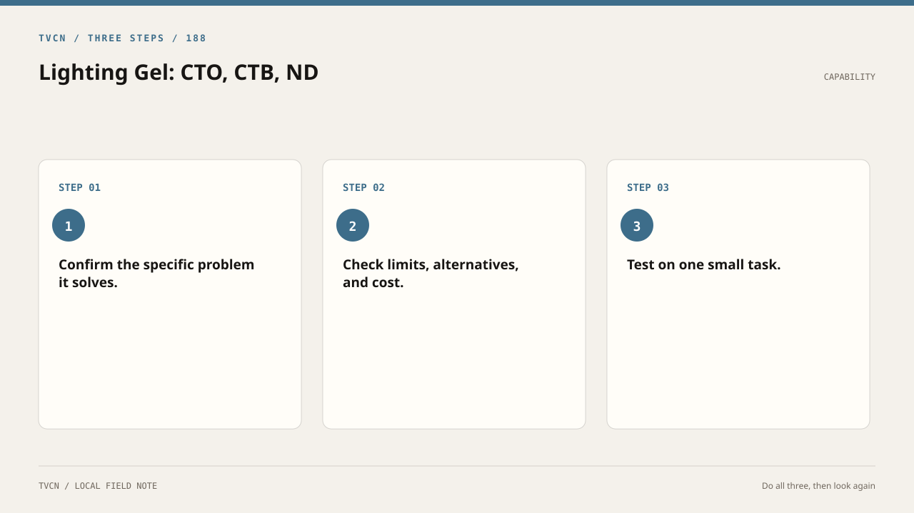

For precise, repeatable light reduction, use lens ND or electronic ND, not a guess with a gel. Gels are for color and atmosphere, not measurement.

<!-- DIAGRAM_START -->
<h2>Diagram</h2>
<figure>
  
  <figcaption>Watch “CTO on a window, CTB on a lamp,” and “ND gel only dims without shifting color.”; judge whether the spec maps to one concrete shooting problem.</figcaption>
</figure>
<!-- DIAGRAM_END -->
<section><h2 id="section-1">Test the color shift</h2><ul><li><strong>Density:</strong> shoot white paper and a gray card at the final light position with 1/4, 1/2 and full ND; compare color temperature and density.</li><li><strong>Stacking:</strong> multiple ND gels add cast and vignetting; use one gel of the needed density where possible.</li><li><strong>Heat:</strong> gels melt too close to a fixture; use a gel frame and distance, and check LED cooling too.</li></ul><h2 id="section-2">When not to use it</h2><h2 id="section-3">Do not stack more than two gels</h2>

CTO/CTB correct color temperature; ND lowers brightness. Stacking both shifts color, reduces sharpness and can add IR pollution. Decide whether you need a color shift before adding ND.

<ol><li>Daylight too blue: 1/4 CTO. Tungsten too warm: 1/4 CTB. Add a quarter at a time.</li><li>Put ND on the lens or window, not against the color gel. For deep cuts, use one strong ND, not three weak ones.</li><li>Set LED color and brightness first; gels are for trim, not for fixing a bad lamp.</li></ol>

Acceptance: white-balance and check white paper and skin, not the lamp. Green cast or vignette means remove a layer.
</section><section><h2 id="section-4">On set</h2>
Put CTO on the window and CTB on the lamp, then check the color temperature. ND gel only cuts brightness; it does not shift color.
</section><section><h2 id="section-5">Do this</h2>
Lighting gels split into CTO, CTB, and ND: warm, cool, and dim; the wrong gel changes the whole set.
<ol><li>CTO on a window, CTB on a lamp, shoot and read color temperature.</li><li>ND gel only dims without shifting color.</li><li>Label each gel with name and strength instead of judging by color.</li></ol></section><section><h2 id="section-6">Avoid</h2>
Do not sort gels by eye; CTO and ND can both look orange in the dark.
</section>
<h2>Check</h2><ul><li>CTO and CTB each have a comparable color-temperature sample.</li><li>ND changes brightness without shifting color temperature.</li><li>Each gel carries a name and strength label.</li></ul>
