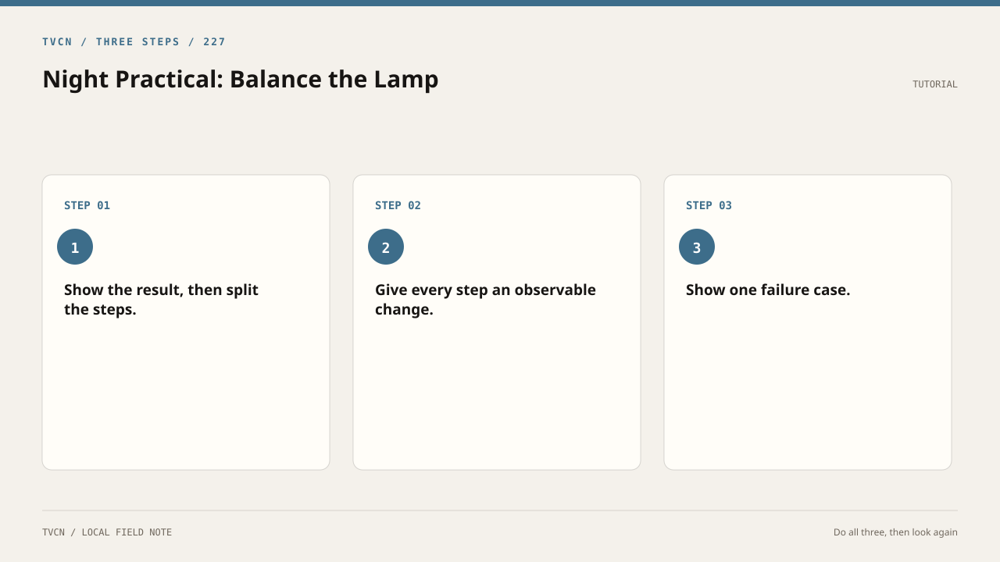

In a practical-lit night scene, keep lamps and windows colored, not blown to white. Lift the face half a stop with a small fill or wall bounce and leave the rest to post; control noise on set rather than fixing it later.

<!-- DIAGRAM_START -->
<h2>Diagram</h2>
<figure>
  
  <figcaption>Watch “Keep the practical in frame at 30 percent” and “Fill the face from the side with a”; judge whether the spec maps to one concrete shooting problem.</figcaption>
</figure>
<!-- DIAGRAM_END -->
<section><h2 id="section-1">Protect highlights, then lift the shadows</h2>
Play back a take and check shadows for blocks and flicker. If present, add ambient light or a higher-latitude mode; do not rely on lifting in post.
<h2 id="section-2">Limits</h2>
Night is not a brighter image. Blacks must stay black and lamps must read; a uniformly gray frame stops being night.
</section><section><h2 id="section-3">On set</h2>
Keep the practical in frame at 30 percent brightness. Add a small side light for the face and leave the background dark.
</section><section><h2 id="section-4">Do this</h2>
Night practicals first make the lamp in frame believable, then a small light fills the face; too much difference looks fake.
<ol><li>Keep the practical in frame at 30 percent brightness.</li><li>Fill the face from the side with a small light.</li><li>Keep the background dark instead of lifting everything.</li></ol></section><section><h2 id="section-5">Avoid</h2>
Do not lift the whole street; a flat night kills the practical motivation.
</section><section><h2>Judge</h2>
This page passes on three observable checks, not slogans:
<ul><li><strong>1.</strong> The practical in frame sits near 30 percent without blowing out.</li><li><strong>2.</strong> The face is filled from the side, not flat frontal light.</li><li><strong>3.</strong> The background stays dark and does not become daytime.</li></ul></section><section><h2>Failures</h2>
Any one of these means stop and fix it before post:
<ul><li><strong>1.</strong> Check 1 is only staged (“The practical in frame sits near 30 percent wi…”); another camera position or location exposes it.</li><li><strong>2.</strong> Check 2 is left to post or a verbal explanation (“The face is filled from the side, not flat fro…”); nothing on set can be rechecked.</li><li><strong>3.</strong> Do not lift the whole street; a flat night kills the practical motivation.</li></ul></section><section><h2>Extend</h2>
<strong>10-minute exercise:</strong> Run a 60-second test with the gear you already own, measuring only “Keep the practical in frame at 30 percent”. Record two numbers: what you need and what the gear actually gives.
</section>
<h2>Check</h2><ul><li>The practical in frame sits near 30 percent without blowing out.</li><li>The face is filled from the side, not flat frontal light.</li><li>The background stays dark and does not become daytime.</li></ul>

<!-- SOURCES_START -->
## References and further reading

- [S23] [SMPTE: Standards](https://www.smpte.org/standards) — Accessed 2026-11-26. Used to check the terminology/method/rule in the “Protect highlights, then lift the shadows” section against SMPTE standards portal, not specific camera specs; it does not verify numbers, model choices or on-set conclusions derived from this page, and is not a substitute for a test.
- [S29] [YouTube: Upload Encoding Specs](https://support.google.com/youtube/answer/1722171) — Accessed 2026-11-26. Used to check the terminology/method/rule in the “Limits” section against YouTube upload encoding recommendations, not creative standards; it does not verify numbers, model choices or on-set conclusions derived from this page, and is not a substitute for a test.
<!-- SOURCES_END -->

