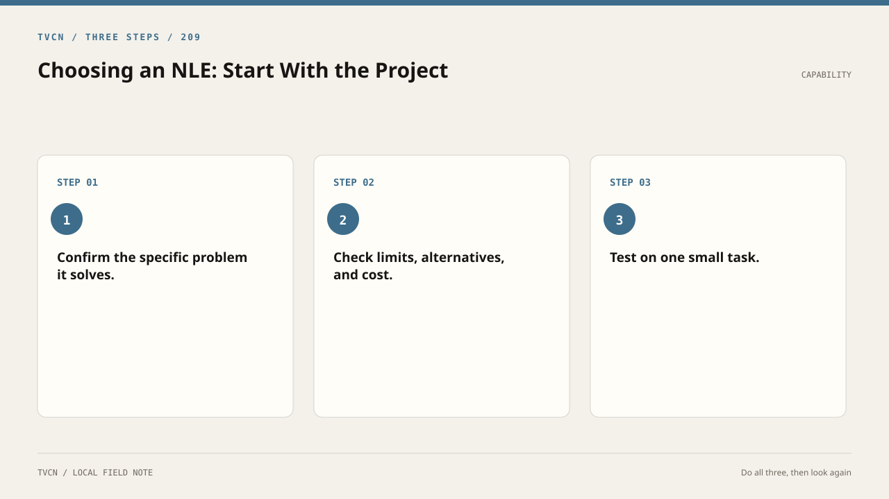

Choose an NLE by project needs: collaboration, proxies, grading, subtitles, delivery; not by tutorial count.

<!-- DIAGRAM_START -->
<h2>Diagram</h2>
<figure>
  
  <figcaption>Do the three steps in order, then look again at the image or file.</figcaption>
</figure>
<!-- DIAGRAM_END -->
<h2>On set</h2>

Cut one minute of the same footage in three apps. Compare proxies, collaboration, subtitles, and export before choosing.

<h2>Do this</h2>

Choose an NLE by project: collaboration, proxies, grading, subtitles, delivery; not by tutorial count.
<ol><li>Cut one minute of the same footage in three apps.</li><li>Compare proxies, collaboration, subtitles, and export.</li><li>Decide by the project's weakest requirement.</li></ol>
<h2>Avoid</h2>

Do not choose by tutorial volume; if the project lacks collaboration, tutorials cannot fix it.

<h2>Check</h2>
<ul><li>One minute is cut in three apps from the same footage.</li><li>Proxies, collaboration, subtitles, and export are compared.</li><li>The choice follows the project's weakest need, not popularity.</li></ul>
