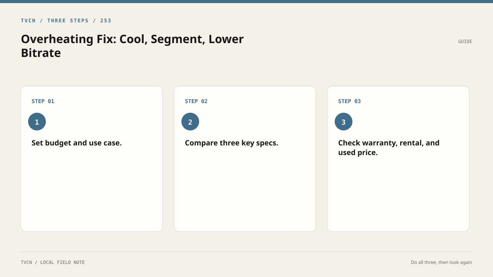

Cool it, shoot in segments, lower bitrate; do not put a wet towel on the body.

<!-- DIAGRAM_START -->
<h2>Diagram</h2>
<figure>
  
  <figcaption>Do the three steps in order, then look again at the image or file.</figcaption>
</figure>
<!-- DIAGRAM_END -->
<h2>On set</h2>

Lower the bitrate, turn off stabilization, open the battery door, and shoot in shorter takes. Never put a wet towel on the body.

<h2>Do this</h2>

Overheating: cool it, shoot in blocks, lower the bitrate. Do not put a wet towel on the body.
<ol><li>Lower resolution or bitrate and turn off in-body stabilization and long monitoring.</li><li>Open the battery door or add a heat sink; keep the body out of direct sun.</li><li>Stop for five minutes every twenty and shoot in shorter blocks.</li></ol>
<h2>Avoid</h2>

Do not use a wet towel or ice pack directly; condensation shorts the camera.

<h2>Check</h2>
<ul><li>Resolution or bitrate is lower and stabilization and long monitoring are off.</li><li>The battery door or heat sink is handled and the body is out of direct sun.</li><li>The camera stops five minutes every twenty and shoots in blocks.</li></ul>
