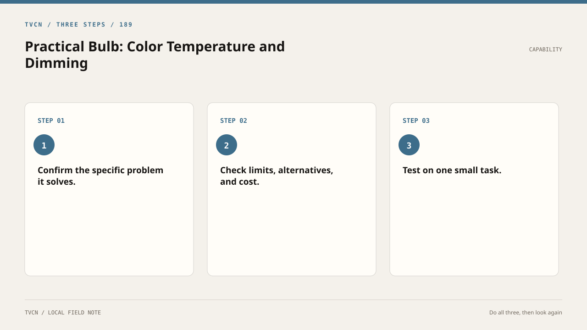

For repeatable output, long shoots or mixing with film lights, do not use an uncontrolled household bulb. It works as an in-frame practical, not as a key light.

<!-- DIAGRAM_START -->
<h2>Diagram</h2>
<figure>
  
  <figcaption>Watch “Use a tunable bulb and set it to” and “Put it on a dimmer at 30 percent.”; judge whether the spec maps to one concrete shooting problem.</figcaption>
</figure>
<!-- DIAGRAM_END -->
<section><h2 id="section-1">Test three things</h2><ul><li><strong>Dimming:</strong> take it from 100% to 10% and watch for flicker, color shift or steps; cheap LEDs often fail at low output.</li><li><strong>Color temperature:</strong> compare with a gray card and camera white balance; confirm whether the claimed 3200K/5600K is real.</li><li><strong>Color rendering:</strong> shoot skin and a red cloth, not only a white wall; poor rendering makes skin gray and red muddy.</li></ul><h2 id="section-3">Practical bulbs: dim first, then color</h2>

A table lamp or wall sconce is not “turn it on.” Mains bulbs flicker, drift in color and cannot be dimmed. Replace with dimmable LED or add a dimmer before the shoot.

<ol><li>Look through the viewfinder for flicker; banding means change the bulb or set shutter to a multiple of local mains frequency.</li><li>Use 2700K or 3200K, within half a stop of the key. A big mismatch reads as two rooms.</li><li>Dim it below clipping; shape the pool with a flag, not with post.</li></ol>

Acceptance: shoot ten seconds and check flicker around the bulb and green skin. Flicker means change the lamp, not fix it in post.
</section><section><h2 id="section-4">On set</h2>
Use a tunable bulb at 3200K on a dimmer at 30 percent and check whether it still reads as the motive.
</section><section><h2 id="section-5">Do this</h2>
A practical bulb must dim and shift color, or the lamp in frame is only a prop, not a source.
<ol><li>Use a tunable bulb and set it to 3200K.</li><li>Put it on a dimmer at 30 percent.</li><li>Shoot and see whether it still motivates the light in frame.</li></ol></section><section><h2 id="section-6">Avoid</h2>
Do not use a fixed household bulb; it blows out and becomes a prop only.
</section>
<h2>Check</h2><ul><li>The bulb reaches 3200K and runs on a dimmer.</li><li>At 30 percent the lamp in frame does not blow out.</li><li>It motivates the nearby key light.</li></ul>

<!-- SOURCES_START -->
## Experience note

Experience note:This page draws on 7 gear trials and on-set playbacks under the listed model/firmware, once indoors and once outdoors; it covers the selection and use limits of “Practical Bulb: Color Temperature and Dimming”, not an external laboratory test, unlisted models, unit-level QC, warranty/rental contracts or safety certification.
<!-- SOURCES_END -->

