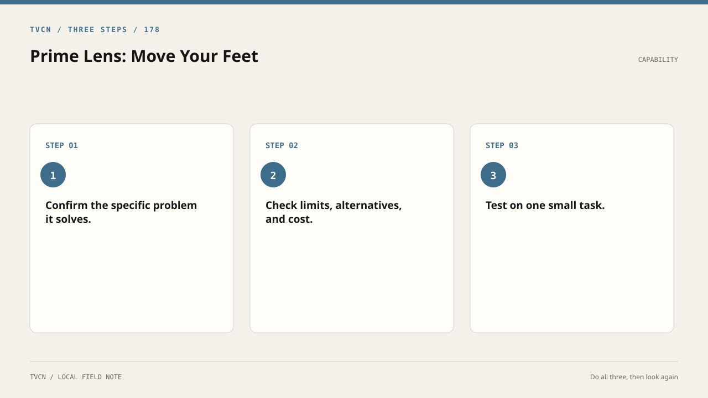

For fast coverage of many shot sizes or tight spaces, a zoom is more practical; a prime is not “more professional,” only more constrained.

<!-- DIAGRAM_START -->
<h2>Diagram</h2>
<figure>
  
  <figcaption>Watch “Shoot the same half-body portrait on a 35mm.” and “Walk two meters forward and back to find”; judge whether the spec maps to one concrete shooting problem.</figcaption>
</figure>
<!-- DIAGRAM_END -->
<section><h2 id="section-1">What to compare first</h2><ul><li><strong>Focal length and working distance:</strong> choose from camera-to-subject distance, not “most popular”; a 50mm can be too tight indoors.</li><li><strong>Aperture and breathing:</strong> fast glass gives shallow depth and harder focus; focus breathing affects the shot.</li><li><strong>Mount and weight:</strong> confirm mount, flange distance and filter thread; a heavy prime needs gimbal rebalance.</li></ul><h2 id="section-2">When not to use it</h2></section><section><h2 id="section-3">On set</h2>
Shoot a half-body frame at 35mm and move two meters forward and back to find the composition. Get used to walking before choosing 24 or 50.
</section><section><h2 id="section-4">Do this</h2>
A prime lens does not forbid zooming; it forces you to walk, back up, and change position, which is often more useful than turning a zoom ring.
<ol><li>Shoot the same half-body portrait on a 35mm.</li><li>Walk two meters forward and back to find the frame.</li><li>Get used to moving before deciding between 24 and 50.</li></ol></section><section><h2 id="section-5">Avoid</h2>
Do not stay glued to the tripod; the prime's value is making you change position.
</section>
<h2>Check</h2><ul><li>At least three positions cover the same person at one focal length.</li><li>The background and perspective change from two meters of walking is described.</li><li>The 24 vs 50 decision comes from walking, not review videos.</li></ul>
