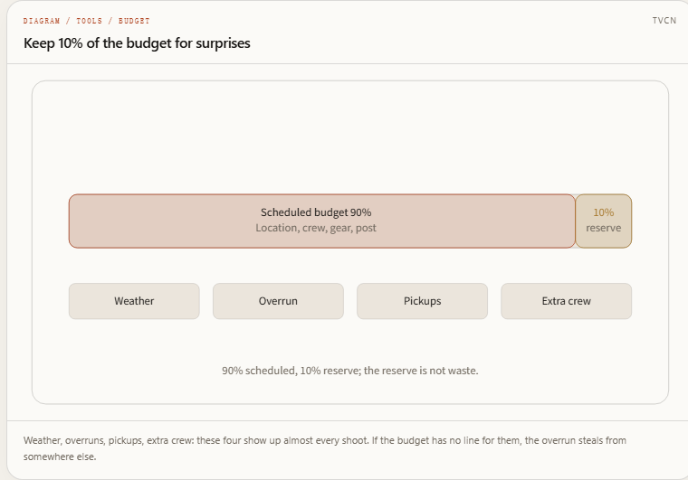

<!-- DIAGRAM_START -->
## Diagram

<figure>
  
  <figcaption>Weather, overruns, pickups, extra crew: these four show up almost every shoot. If the budget has no line for them, the overrun steals from somewhere else.</figcaption>
</figure>
<!-- DIAGRAM_END -->

## List the four likely surprises

Exteriors depend on weather. Interiors depend on when the location closes. Cast depends on availability. Gear depends on whether there is a backup. Write one worst case for each, multiply by a number you can survive, and put it in the budget.

I watched a two-day shoot lose an afternoon to rain. The crew waited three hours. Because the budget held money for another day of rent, they picked up the missing scenes the next morning. A crew without that line would have moved a night scene to daylight and changed the mood of the whole film.

## Hold ten percent, with a rule

Ten percent is not “we will figure it out.” It is three rules written in advance: weather overtime comes from this line; cast reshoots do not; gear damage can use half. With the rules on paper, spending it does not require an argument.

If you spend it, cut the same amount somewhere else. Otherwise it is not a buffer. It is a quieter budget increase.

## Keep overruns on one page

Before wrap each day, write three lines: what you spent, how far over plan it is, and what is due tomorrow. Do not wait until the shoot ends to total it; by then nothing can change.

The client version can be one page. You still need to know why each line moved. Next time you quote, those numbers are your footing.

## Three checks

- The budget has a separate contingency line of at least ten percent.
- The rules for using it were written before the first day.
- At every wrap, you can say how much today went over and why.

<!-- V11_DEEPEN -->

<section><h2>Boundary</h2>
This page only covers “Hold Ten Percent for the Unexpected”; it does not replace Budget: Four Buckets, One Decision, Budget and Quote: Put Risk into the Number, Cross the Line and the Room Disappears. When the problem belongs to one of those pages, use that page instead of adding more parameters here.
</section>
<!-- SOURCES_START -->
## References and further reading

- [S41] [WGA: Contract and Credit Resources](https://www.wga.org/) — Accessed 2026-11-26. Used to check the terminology/method/rule in the “List the four likely surprises” section against WGA contract and credit resources, not Chinese employment law; it does not verify numbers, model choices or on-set conclusions derived from this page, and is not a substitute for a test.
- [S22] [NPC: Civil Code](http://www.npc.gov.cn/npc/c2/c30834/202006/t20200602_306457.html) — Accessed 2026-11-26. Used to check the terminology/method/rule in the “Hold ten percent, with a rule” section against China's Civil Code, not industry custom; it does not verify numbers, model choices or on-set conclusions derived from this page, and is not a substitute for a test.
<!-- SOURCES_END -->

