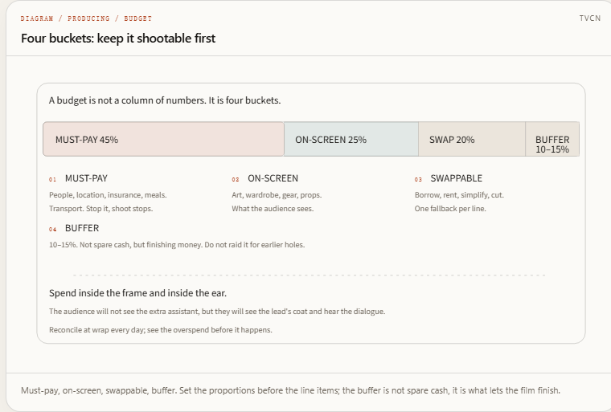

<!-- DIAGRAM_START -->
## Diagram

<figure>
  
  <figcaption>Must-pay, on-screen, swappable, buffer. Set the proportions before the line items; the buffer is not spare cash, it is what lets the film finish.</figcaption>
</figure>
<!-- DIAGRAM_END -->

A budget is not a column of numbers. It is four buckets. Keep the film shootable before you make it pretty.

## Four buckets: must-pay, on-screen, swappable, buffer

Must-pay: people, location, insurance, meals, transport. If this stops, the shoot stops. On-screen: art, wardrobe, gear, props. What the audience actually sees. Swappable: what can be borrowed, rented, simplified, or cut. Buffer: 10–15%, and do not touch it.

Set the proportions before you fill in the details. Do not start with “what I want to buy.” Start with “which bucket cannot stop.”

## Spend inside the frame and inside the ear

The audience will not notice the extra assistant. They will notice the lead's coat and hear the dialogue. Protect what is on screen and what is in the ear. A great location beats expensive gear; a good microphone in a quiet room beats a fancy one in a bad room.

If it can be borrowed, write borrowed. If it can be rented, write rented. If it is yours, write yours. A zero still needs a reason, or it becomes a new cost on set.

## Every line gets a fallback

Add a “cheaper option” column to every expense: borrow, rent, reduce, replace, cut. Update the sheet as reality changes, one change at a time, and leave the buffer alone. Reconcile at wrap each day, not after the money is gone.

A budget is not for the accountant. It is for the decisions on set. Write down which line can be cut on the day and which line stops the shoot if cut.

## Checks

- The four buckets have proportions, and the buffer has not been raided.
- Every line has a cheaper option, not just a total.
- Actuals are updated daily, so overspend is visible before it happens.
