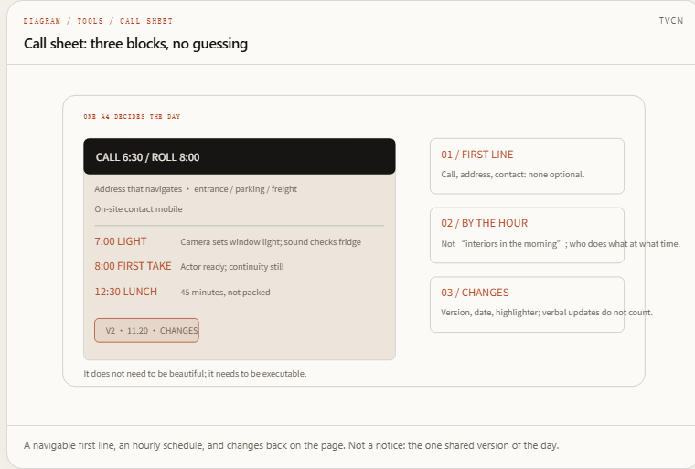

<!-- DIAGRAM_START -->
## Diagram

<figure>
  
  <figcaption>A navigable first line, an hourly schedule, and changes back on the page. Not a notice: the one shared version of the day.</figcaption>
</figure>
<!-- DIAGRAM_END -->

A call sheet is not a form for the producer. It is the one version the whole crew shares on the day: who arrives when, where, with what, and whom to call when something goes wrong.

## The first line is call time, not roll time

Call time and roll time are different. Call is when people arrive, eat, and change. Roll is when the first frame turns over. Put both at the same time and someone will be late, while someone else stands around.

Write an address that navigation can find. “The noodle place in the old town” is not an address. Add the entrance, parking, the freight elevator, and which door to use. A driver or a first-timer should be able to arrive from the first line alone.

Put a mobile number for the on-site contact, not “ask in the group chat.” Add the weather and the backup plan: move inside if it rains, or push the day. The worst thing on a shoot is not rain; it is the whole crew waiting for one person to decide.

## Schedule by the hour, not by department

Do not write “interiors in the morning, exteriors after lunch.” Every department will prepare against a different idea of that. Write times: 6:30 call, 7:00 lighting, 8:00 first take, 12:30 lunch, 13:30 move.

After each slot, name who does what and what they need. “7:00 camera enters the kitchen, set the window light; sound measures the fridge hum; art swaps the bill on the table for version two.” One line and three departments know their next move.

Leave buffers. Moving, card offloads, makeup, waiting for light all take time. A full day breaks at the first delay.

## Keep changes on paper

Number the version and date it. When V1 changes, say “read V2” in the group; do not let people guess which one is live. Mark on-set changes with a highlighter, and send the next day’s sheet before wrap.

Verbal updates disappear in the wind. A changed time, a new location, an extra wardrobe piece: put it back on the page. The set is already loud; do not add memory work.

The sheet does not need to be beautiful. It needs to be executable. One clear A4 beats a polished shared doc nobody can find on the day.

## Checks

- The first line has call time, a navigable address, and an on-site phone number.
- The schedule runs by the hour, with who does what in each slot.
- Version, date, and changes are marked, and the next sheet goes out before wrap.

<!-- DEEP_DIVE_START -->
## Deep dive

<strong>About 7 minutes.</strong> A call sheet is not a table for the producer. It is how the whole crew believes the same thing on the same morning: when, where, what.

### The call sheet is the day's single source of truth

The most expensive thing on set is not gear; it is fifteen people each believing a different plan. A call sheet must have one version: the filename carries the date and version number, and you confirm everyone received the same one. “Check the latest” in a group chat means nothing; everyone's “latest” differs.

Also state the release time: first version at noon the day before, confirmed version before wrap for the next day. For changes, start with “V2 replaces V1” and do not bury the change in chat history. The sheet does not need to be beautiful, but the call time, address, and contact must be findable at a glance on a phone.

### Six fields, one time block per row

The minimum executable call sheet has six columns: time, scene, cast and props, owner, contact, notes. Each row is a time block, not a department block such as “camera” or “sound.” Department blocks let each group prepare by its own reading; time blocks align everyone.

Example: 07:30 meet at the river, 08:00 first wide, 09:30 close-up, 11:00 move to the cafe, 12:30 lunch. Put an owner and a phone number on each row; never “ask in the group.” Who opens the door, who handles parking, who brings the permit copy: all in notes, not in someone's head.

### Write an address people can navigate to, not a city

“The noodle place in the old town” is not an address. Write the street number, entrance, floor, freight elevator, which door opens, where to park, the nearest subway exit. A first-timer should arrive from this row alone; the driver should not need to call for directions.

Add four location facts: nearest toilet, route to the nearest hospital, where to buy water, whether there is signal at the set. They look trivial, but each saves ten minutes at the worst moment. The address is not for the producer; it is for the person who left at five in the morning and has never been there.

### Put the time budget in the sheet

Do not write “morning: exteriors.” Write call, lighting, roll, first shot, move, lunch, wrap; leave fifteen to thirty minutes of buffer after each stage. Moves, card changes, makeup, and waiting for light all take time. A packed schedule fails at the first item.

Work backward from sunset: the last exterior must be done forty minutes before sunset, leaving time for pickups and gear. Do not start looking for a restaurant at 12:30; state who buys lunch, when it arrives, where people eat. A schedule is not a wish; it is a budget. If it overruns, cut shots, not safety.

### Change control: verbal notes disappear

On-set changes have only three legitimate forms: highlight it on paper, post “V2 replaces V1” in the group, or send the confirmed next-day version before wrap. Saying “we move to three” does not count; someone did not hear, and someone heard two.

Every change states three things: what changed, why, and who is affected. A location change means resending the address and parking; a time change means reworking lunch and transport; a shot change means confirming props and cast are still there. A change is not a message; it is a realignment.

### The next version after wrap

Spend ten minutes before wrap writing the “as-built” version: which shot overran, which one was skipped, what is first tomorrow, who needs to arrive early. Write actual times back into the sheet; tomorrow's schedule needs evidence. Do not re-plan from memory; memory keeps only the smoothest or the worst part.

The call sheet is not finished when it is sent. It is finished when it is useful after wrap. Tomorrow's version carries today's lesson: if lighting always overruns, move lighting earlier; if the move always hits traffic, change the meeting point. A sheet is worth it when the same mistake happens only once.

### Ten call-sheet checks
<ul><li>Filename has date and version</li><li>Call time separate from roll time</li><li>Each row is a time block</li><li>Six columns complete: time, scene, cast, owner, phone, notes</li><li>Address includes street number and entrance</li><li>Parking, toilet, hospital stated</li><li>Buffer after every stage</li><li>Exteriors scheduled backward from sunset</li><li>Change states what, why, who</li><li>Next-day confirmed version sent before wrap</li></ul>
If the call sheet is unclear, the set spends phone-call time making decisions that ten minutes of writing could have settled.

<!-- DEEP_DIVE_END -->

<!-- SOURCES_START -->
## References and further reading

- [S41] [WGA: Contract and Credit Resources](https://www.wga.org/) — Accessed 2026-11-26. Used to check the terminology/method/rule in the “The first line is call time, not roll time” section against WGA contract and credit resources, not Chinese employment law; it does not verify numbers, model choices or on-set conclusions derived from this page, and is not a substitute for a test.
- [S22] [NPC: Civil Code](http://www.npc.gov.cn/npc/c2/c30834/202006/t20200602_306457.html) — Accessed 2026-11-26. Used to check the terminology/method/rule in the “Schedule by the hour, not by department” section against China's Civil Code, not industry custom; it does not verify numbers, model choices or on-set conclusions derived from this page, and is not a substitute for a test.
<!-- SOURCES_END -->

