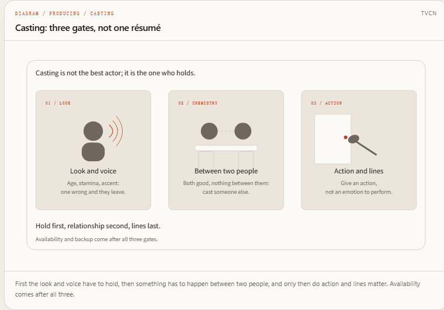

<!-- DIAGRAM_START -->
## Diagram

<figure>
  
  <figcaption>First the look and voice have to hold, then something has to happen between two people, and only then do action and lines matter. Availability comes after all three.</figcaption>
</figure>
<!-- DIAGRAM_END -->

## Write what they do, not what they are like

Before casting, turn the character into actions: when he wakes up, how he opens a door, where his hands go while he waits, where he looks when he lies. Do not write “gentle,” “repressed,” or “has a past.” An actor can only guess at adjectives.

Then list three things you cannot replace: voice, walk, and the way they look at people. A face can be dressed; a coat can be changed; those three are hard to swap. Age, stamina, accent, and the marks of a job: if one is wrong, the audience leaves the room on the first look.

## Audition: give an action, not a monologue

Ask the actor to do one concrete thing: wait for someone, open a door, hide an object, push a cup away. The line is part of the action, not the whole performance. Watch how they breathe inside it, where they pause, how they avoid the lens.

Do not ask for “sad.” Ask them to hold back something they need to say; the audience will fill it in. Record the audition. On playback, mute it and watch whether they are waiting or performing waiting.

## Two people in a room make a relationship

Being good alone does not count. Put two actors across from each other and watch height, tempo, who blinks first, who listens while the other talks. If each is good and nothing happens between them, cast someone else.

Do not only read the most heated scene. Read a meal, a search for keys, a call where neither wants to hang up first. Ordinary scenes reveal whether they are family, coworkers, or ex-lovers.

## Availability and backup matter as much as the performance

Confirm how many days they can work, whether they can stay late, and whether they have stage or camera experience. If one actor cannot come, the whole schedule moves; keep a backup for every lead.

After you cast, send the character notes, script, and shoot dates together. Do not send “you got it” and let them arrive on set without knowing the part.

## Checks

- Is the character note built from actions, not adjectives?
- Did the audition give an action rather than a monologue?
- With two actors in the room, does something happen between them?
- Are availability, backup, and character materials written down?
