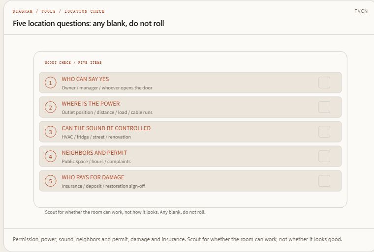

<!-- DIAGRAM_START -->
## Diagram

<figure>
  
  <figcaption>Permission, power, sound, neighbors and permit, damage and insurance. Scout for whether the room can work, not whether it looks good.</figcaption>
</figure>
<!-- DIAGRAM_END -->

A location is not a place that looks right. Answer five questions before you move the gear in.

## Who can actually say yes

A location is not a place that looks right. Ask who owns it, who manages it, and who can open the door on the day. If the owner, tenant, building manager, or landlord has not agreed, the shoot can stop.

A verbal yes is not permission. Put the date, hours, crew size, equipment, power, noise, parking, bathrooms, and cleanup in writing. The person who signs must be able to stand behind it, not an intermediary who “thinks it should be fine.”

If the shoot blocks a door, takes a public way, or affects neighbors, check the local rules. Do not treat “nobody will notice” as a permit.

## Can the room actually work

Do not scout only for the frame. Walk the carry route: is the door wide enough, can the stairs take the cases, does the elevator need booking, can you park nearby. Then check power: where the outlets are, how far they run, what the total load is. Do not discover on the day that you need three extension runs.

Listen to the room: HVAC, fridge, street traffic, a neighbor’s renovation. Record a thirty-second test and play it back for the noise floor. You can add light; you cannot add silence.

Finally, check time: when the window light arrives and leaves, when the owner closes, when the neighbors sleep. The room’s light and business hours will rewrite your schedule.

## Put the trouble in the plan

For public space, check the local filming permit. For homes and shops, talk to the neighbors before the crew arrives. Carry insurance for gear and third-party damage. Ask how damage is assessed before paying a deposit.

Have a backup location, even if you never use it. Put the location contact on the first line of the call sheet. Restore the room before wrap, let the owner inspect it, then settle the deposit. Do not promise “we will be back” unless you mean it.

The relationship is a long-term asset. A clean wrap makes the next door, outlet, and quiet hour much easier to borrow.

## Checks

- Written permission covers dates, hours, crew, power, and cleanup.
- Carry route, power, and noise floor are tested on site.
- Permit, insurance, and a backup location are arranged.
