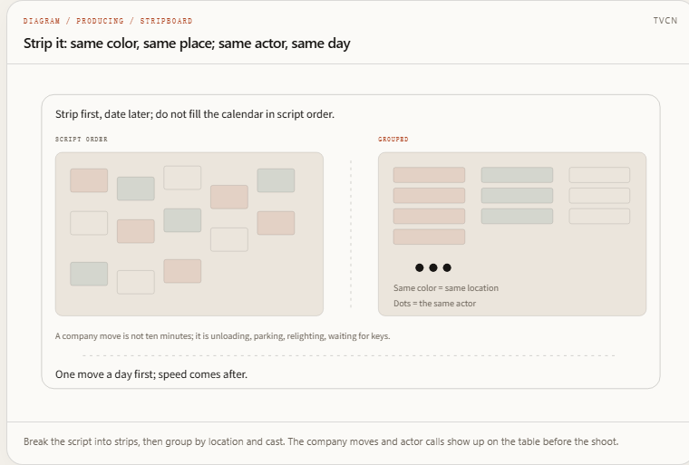

<!-- DIAGRAM_START -->
## Diagram

<figure>
  
  <figcaption>Break the script into strips, then group by location and cast. The company moves and actor calls show up on the table before the shoot.</figcaption>
</figure>
<!-- DIAGRAM_END -->

Scheduling is not filling the calendar in script order. Break the script into strips, then group them. One company move a day, one actor call. The schedule protects the performance, not just the progress.

## Strip first, dates later

One strip per scene: location, day or night, cast, page count, props, special needs. Color every strip at the same location the same color; put strips that share an actor next to each other. Do this before dates and you will see “three company moves today” before noon, not after.

Write the reason a scene cannot move: daylight, shop hours, actor availability, a special prop. If you cannot name the reason, it can move.

## Group by location and cast

Keep one location per day when you can. A company move is not ten minutes; it is unloading, parking, relighting, waiting for keys. Half a day is gone. If an actor is available for one day only, put all their scenes on that day, even if the script separates them by ten pages.

Do not force day and night into the same day. Switching to night means waiting for the sun while the whole crew costs money. Better to add a shoot day than ask an actor to play a clear-headed scene at three in the morning.

## Start easy, end with the shot you need

Put the simplest scene on day one and let the crew find its rhythm. Start each day with a shot that can stand alone; end with the shot you must have. If weather turns, shoot interiors first, then go outside.

The board is not a contract. It is the thing you make decisions against. When it changes, write the change on the call sheet; do not leave it in a group chat.

## Checks

- Every strip carries location, day or night, cast, pages, and special needs.
- Does the day hold one location where possible, and one actor call?
- Does each day have an easy start and a must-get ending?
