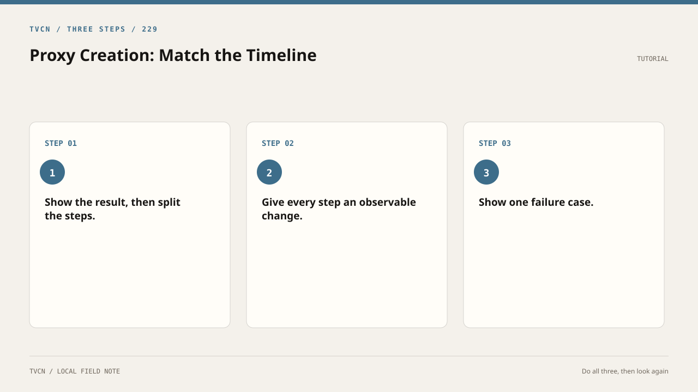

Do not rename files or change folder structure when generating proxies. The editor relinks by original name and timecode; renaming turns relinking into manual hunting.

<!-- DIAGRAM_START -->
<h2>Diagram</h2>
<figure>
  
  <figcaption>Watch “Generate quarter-resolution ProRes Proxy.” and “Keep them on a separate SSD.”; judge whether the spec maps to one concrete shooting problem.</figcaption>
</figure>
<!-- DIAGRAM_END -->
<section><h2 id="section-1">Proxies keep names, timecode and reel</h2>
Pick proxy resolution from timeline needs: multicam 4K can go to 1080p or 720p, but frame rate and color space must match the original.
<h2 id="section-2">Limits</h2>
A proxy is not delivery. Before the master, confirm the timeline points at originals; exporting from proxies loses a generation.
<h2 id="section-3">Proxy specs: editable, relinkable, never the master</h2>

A proxy is not “just a small file.” It must relink at the same timecode, frame rate and filename, or the cut shifts when you return to the original.

<ol><li>Common: 1080p ProRes Proxy or high-bitrate H.264, same frame rate as source, audio kept.</li><li>Add <code>_proxy</code> to the filename; do not change reel names. Relink against the original media path.</li><li>Keep originals separate from the proxy project. Never grade the proxy as final.</li></ol>

Acceptance: pick a random cut point and relink to the original; the frame should not shift and audio should stay in sync. If it shifts, check frame rate and timecode.
</section><section><h2 id="section-4">On set</h2>
Make quarter-resolution ProRes Proxy files on a separate SSD. Relink and check timecode and framing.
</section><section><h2 id="section-5">Do this</h2>
Proxies follow timeline and delivery resolution; do not cut at full resolution. Wrong proxies misplace subtitles and framing.
<ol><li>Generate quarter-resolution ProRes Proxy.</li><li>Keep them on a separate SSD.</li><li>On relink, check timecode and framing.</li></ol></section><section><h2 id="section-6">Avoid</h2>
Do not export from proxies; relinking to originals shifts every subtitle.
</section><section><h2>Judge</h2>
This page passes on three observable checks, not slogans:
<ul><li><strong>1.</strong> Proxies are quarter-resolution ProRes Proxy on a separate SSD.</li><li><strong>2.</strong> Timeline and proxy names map back to originals.</li><li><strong>3.</strong> After relink, timecode and framing match the proxy cut.</li></ul></section><section><h2>Failures</h2>
Any one of these means stop and fix it before post:
<ul><li><strong>1.</strong> Check 1 is only staged (“Proxies are quarter-resolution ProRes Proxy on…”); another camera position or location exposes it.</li><li><strong>2.</strong> Check 2 is left to post or a verbal explanation (“Timeline and proxy names map back to originals”); nothing on set can be rechecked.</li><li><strong>3.</strong> Do not export from proxies; relinking to originals shifts every subtitle.</li></ul></section><section><h2>Extend</h2>
<strong>10-minute exercise:</strong> Run a 60-second test with the gear you already own, measuring only “Generate quarter-resolution ProRes Proxy.”. Record two numbers: what you need and what the gear actually gives.
</section>
<h2>Check</h2><ul><li>Proxies are quarter-resolution ProRes Proxy on a separate SSD.</li><li>Timeline and proxy names map back to originals.</li><li>After relink, timecode and framing match the proxy cut.</li></ul>

<!-- SOURCES_START -->
## References and further reading

- [S34] [Adobe: Premiere Pro Guide](https://helpx.adobe.com/premiere-pro/user-guide.html) — Accessed 2026-11-26. Used to check the terminology/method/rule in the “Proxy specs: editable, relinkable, never the master” section against official Premiere Pro guide, not a verdict on workflow quality; it does not verify numbers, model choices or on-set conclusions derived from this page, and is not a substitute for a test.
- [S60] [Apple: Final Cut Pro Guide](https://support.apple.com/guide/final-cut-pro/welcome/mac) — Accessed 2026-11-26. Used to check the terminology/method/rule in the “Proxies keep names, timecode and reel” section against official Final Cut Pro guide, not a verdict on workflow quality; it does not verify numbers, model choices or on-set conclusions derived from this page, and is not a substitute for a test.
<!-- SOURCES_END -->

