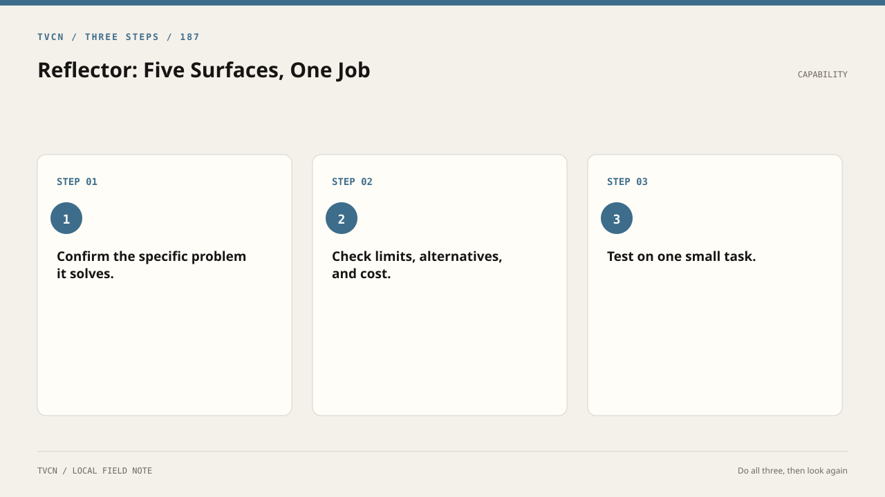

The five surfaces are five fill strengths, not five styles; start white, not silver.

<!-- DIAGRAM_START -->
<h2>Diagram</h2>
<figure>
  
  <figcaption>Do the three steps in order, then look again at the image or file.</figcaption>
</figure>
<!-- DIAGRAM_END -->
<h2>On set</h2>

Start with the white side at 45 degrees on the shadow side. If it is not enough, switch to silver; do not start with gold.

<h2>Do this</h2>

A five-in-one reflector is five fill strengths, not five styles; start white, not silver.
<ol><li>Place the white side at 45 degrees on the shadow side and shoot.</li><li>Switch to silver only if more is needed.</li><li>Use gold only for warmth, never by default.</li></ol>
<h2>Avoid</h2>

Do not start with gold; warm skin is hard to pull back to neutral later.

<h2>Check</h2>
<ul><li>A white-side 45-degree fill sample exists.</li><li>Silver is used only after white proves insufficient, with a comparison.</li><li>Gold is not default, or its warmth is justified.</li></ul>
