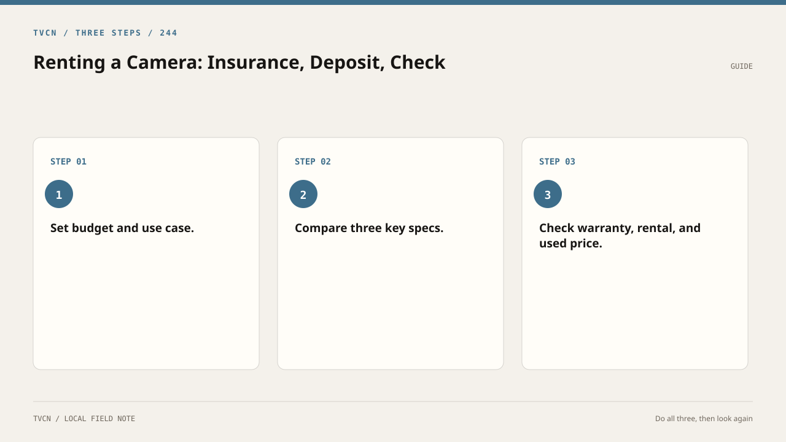

A cheap day rate with no backup, a long pickup and no insurance can cost more than the rental when the camera stops. Ask: same-model backup, early pickup, damage liability, tech support hours.

<!-- DIAGRAM_START -->
<h2>Diagram</h2>
<figure>
  
  <figcaption>Watch “At pickup, shoot 4K video of all six” and “Test recording, autofocus, stabilization, ports, and batteries one”; judge whether the spec maps to one concrete shooting problem.</figcaption>
</figure>
<!-- DIAGRAM_END -->
<section><h2 id="section-1">Rent by downtime cost, not day rate</h2>
Test card slots, sensor, audio and battery at pickup; do not discover it on set.
<h2 id="section-2">Limits</h2>
Do not save rent by taking an unfamiliar body. Learning the menu on set spends the crew's money on your lesson.
</section><section><h2 id="section-3">On set</h2>
Shoot a 4K video at pickup: six sides, mount, sensor, shutter. Repeat before returning it.
</section><section><h2 id="section-4">Do this</h2>
Renting a camera: buy insurance, pay the deposit, and inspect it in person. Record scratches and dead pixels.
<ol><li>At pickup, shoot 4K video of all six sides, mount, sensor, shutter, and screen.</li><li>Test recording, autofocus, stabilization, ports, and batteries one by one.</li><li>Shoot the same pass before returning and compare it with the pickup video.</li></ol></section><section><h2 id="section-5">Avoid</h2>
Do not rely on stills; video proves whether a mark was pre-existing or new.
</section><section><h2>Judge</h2>
This page passes on three observable checks, not slogans:
<ul><li><strong>1.</strong> Pickup video covers six sides, mount, sensor, shutter, and screen in 4K.</li><li><strong>2.</strong> Recording, autofocus, stabilization, ports, and batteries were tested.</li><li><strong>3.</strong> The same pass is shot before return and compared.</li></ul></section><section><h2>Failures</h2>
Any one of these means stop and fix it before post:
<ul><li><strong>1.</strong> Check 1 is only staged (“Pickup video covers six sides, mount, sensor…”); another camera position or location exposes it.</li><li><strong>2.</strong> Check 2 is left to post or a verbal explanation (“Recording, autofocus, stabilization, ports, an…”); nothing on set can be rechecked.</li><li><strong>3.</strong> Do not rely on stills; video proves whether a mark was pre-existing or new.</li></ul></section><section><h2>Extend</h2>
<strong>10-minute exercise:</strong> Run a 60-second test with the gear you already own, measuring only “At pickup, shoot 4K video of all six”. Record two numbers: what you need and what the gear actually gives.
</section>
<h2>Check</h2><ul><li>Pickup video covers six sides, mount, sensor, shutter, and screen in 4K.</li><li>Recording, autofocus, stabilization, ports, and batteries were tested.</li><li>The same pass is shot before return and compared.</li></ul>

<!-- SOURCES_START -->
## References and further reading

- [S32] [Sony Pro Support](https://pro.sony/ue_US/support) — Accessed 2026-11-26. Used to check the terminology and public context in the opening paragraph (“Insurance, deposit, and a hands-on check; film scratches and”) against Support, firmware and documents for pro cameras and lenses; not a substitute for an on-set test.
- [S33] [Canon Support](https://www.usa.canon.com/support) — Accessed 2026-11-26. Used to check the terminology and public context in the opening paragraph (“Insurance, deposit, and a hands-on check; film scratches and”) against Official support for cameras, lenses and firmware; not a substitute for an on-set test.
<!-- SOURCES_END -->

