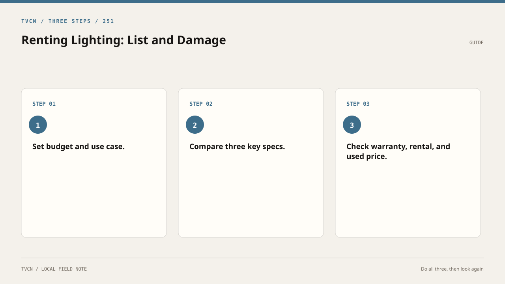

List, test, and photograph the gear; one missing soft box costs an hour on set.

<!-- DIAGRAM_START -->
<h2>Diagram</h2>
<figure>
  
  <figcaption>Do the three steps in order, then look again at the image or file.</figcaption>
</figure>
<!-- DIAGRAM_END -->
<h2>On set</h2>

List every light, softbox, stand, sandbag, and cable. Test each at pickup and video the condition.

<h2>Do this</h2>

Light rental: list every item, test every unit, and record damage. One missing softbox costs an hour on set.
<ol><li>List lights, softboxes, stands, sandbags, cables, and gels.</li><li>Power up each unit and test color temperature and output.</li><li>Video the condition and accessories; compare before returning.</li></ol>
<h2>Avoid</h2>

Do not count heads only; one missing softbox or mount stops the shoot.

<h2>Check</h2>
<ul><li>The list covers lights, softboxes, stands, sandbags, cables, and gels.</li><li>Every unit was powered up and tested for color temperature and output.</li><li>Condition and accessories are videoed and checked before return.</li></ul>
