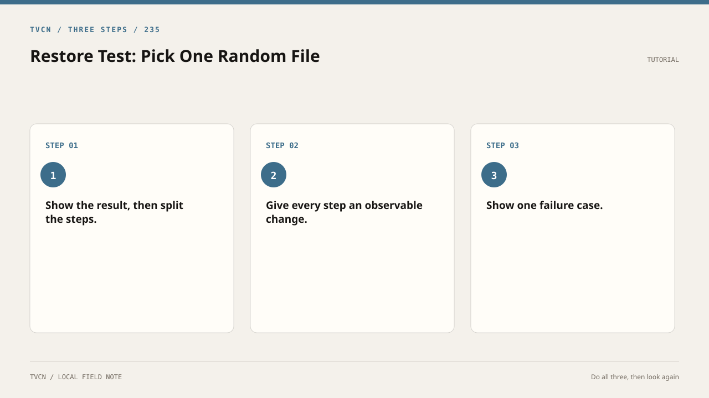

Once a month, restore one random project to a different drive, open it, relink media and export ten seconds. If restore fails, the backup is not there.

<!-- DIAGRAM_START -->
<h2>Diagram</h2>
<figure>
  
  <figcaption>Watch “Pick one file at random.” and “Restore it to another machine.”; judge whether the spec maps to one concrete shooting problem.</figcaption>
</figure>
<!-- DIAGRAM_END -->
<section><h2 id="section-1">A backup passes when it restores, not when it exists</h2>
Record restore time and missing files; if every restore needs manual hunting, the structure or checksum is broken.
<h2 id="section-2">Limits</h2>
RAID and sync folders are not backup. They sync deletions and encryption. Keep one offline, read-only or versioned copy and test restore regularly.
<h2 id="section-3">Restore drill: pick a random file and actually restore it</h2>

A backup that has never been restored is not a backup. Run a 30-minute drill monthly: pick a random project file, restore to a clean disk, open it and compare the hash.

<ol><li>Pick at random, not “the most important,” so you do not only rehearse the familiar path.</li><li>Restore to a machine without the original; never overwrite in place.</li><li>Check size, hash and that it opens. Log the time; over two hours means change the plan.</li></ol>

Acceptance: the file opens, the timeline has no offline media and the hash matches. Missing one means the backup plan is not proven.
</section><section><h2 id="section-4">On set</h2>
Restore one random file to another machine and play it. If it fails, redo the backup.
</section><section><h2 id="section-5">Do this</h2>
A restore drill pulls one random file from backup and opens it; a backup that will not open does not exist.
<ol><li>Pick one file at random.</li><li>Restore it to another machine.</li><li>Open and play; if it fails, redo the backup.</li></ol></section><section><h2 id="section-6">Avoid</h2>
Do not trust a green check in backup software; without a restore, you do not know it opens.
</section><section><h2>Judge</h2>
This page passes on three observable checks, not slogans:
<ul><li><strong>1.</strong> A random file is chosen, not the most familiar one.</li><li><strong>2.</strong> Restore goes to another machine, not the original path.</li><li><strong>3.</strong> The file opens and plays; failures trigger a redo log.</li></ul></section><section><h2>Failures</h2>
Any one of these means stop and fix it before post:
<ul><li><strong>1.</strong> Check 1 is only staged (“A random file is chosen, not the most familiar…”); another camera position or location exposes it.</li><li><strong>2.</strong> Check 2 is left to post or a verbal explanation (“Restore goes to another machine, not the origi…”); nothing on set can be rechecked.</li><li><strong>3.</strong> Do not trust a green check in backup software; without a restore, you do not know it opens.</li></ul></section><section><h2>Extend</h2>
<strong>10-minute exercise:</strong> Run a 60-second test with the gear you already own, measuring only “Pick one file at random.”. Record two numbers: what you need and what the gear actually gives.
</section>
<h2>Check</h2><ul><li>A random file is chosen, not the most familiar one.</li><li>Restore goes to another machine, not the original path.</li><li>The file opens and plays; failures trigger a redo log.</li></ul>

> Intent split: this page covers the practical details of “Restore Test: Pick One Random File”; start with <a href="https://tools.tvcn.org/article/buy-storage/">Buying Project Storage: Speed, Capacity, and Backup</a> for the cluster-level judgement, then return here.

<!-- INTENT_SCOPE -->

<!-- SOURCES_START -->
## Experience note

Experience note:This page draws on 5 production reviews under the listed software/camera versions and delivery platform; it covers the operating order for “Restore Test: Pick One Random File”, not an external laboratory test, unlisted versions, cinema masters, broadcast safety certification or legal advice.
<!-- SOURCES_END -->

