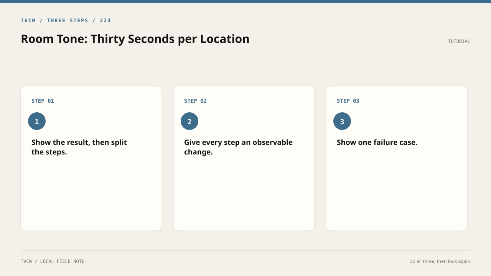

Record thirty seconds of room tone per location with everyone quiet; without it, dialogue cuts sound like a vacuum.

<!-- DIAGRAM_START -->
<h2>Diagram</h2>
<figure>
  
  <figcaption>Do the three steps in order, then look again at the image or file.</figcaption>
</figure>
<!-- DIAGRAM_END -->
<h2>On set</h2>

Record thirty seconds per scene with the crew still. Listen back for air conditioning and refrigerator noise.

<h2>Do this</h2>

Record thirty seconds of room tone per scene with the crew silent; without it, dialogue cuts sound like a vacuum.
<ol><li>Record thirty seconds per scene.</li><li>The whole crew stays still and silent.</li><li>Play back and confirm no air conditioner or refrigerator hum.</li></ol>
<h2>Avoid</h2>

Do not grab room tone during a move; footsteps and chatter come with it.

<h2>Check</h2>
<ul><li>Every scene has a thirty-second room-tone file.</li><li>The crew stays still with no footsteps or chatter.</li><li>Playback contains no sustained air-conditioner or fridge hum.</li></ul>
