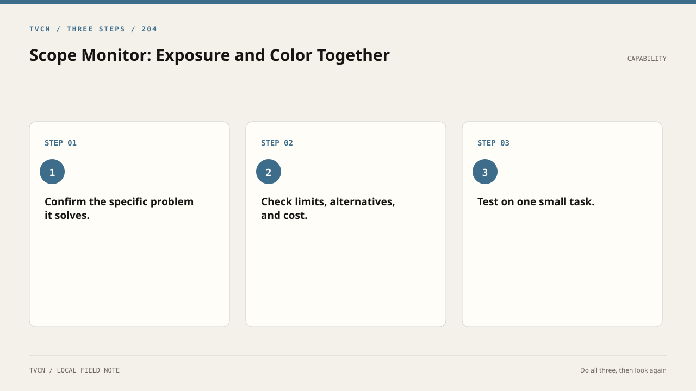

A scope monitor shows exposure and color together; a histogram alone misses skin drift.

<!-- DIAGRAM_START -->
<h2>Diagram</h2>
<figure>
  
  <figcaption>Do the three steps in order, then look again at the image or file.</figcaption>
</figure>
<!-- DIAGRAM_END -->
<h2>On set</h2>

Switch the scope to waveform and vectorscope and shoot a grey card. Black at 0, white at 100, skin line on target.

<h2>Do this</h2>

A scope monitor shows exposure and color together; a histogram alone misses skin shift.
<ol><li>Switch the scope to waveform and vectorscope.</li><li>Shoot a gray card.</li><li>Black at 0, white at 100, skin on the target line.</li></ol>
<h2>Avoid</h2>

Do not read the histogram alone; skin can go green while the histogram looks perfect.

<h2>Check</h2>
<ul><li>Both waveform and vectorscope are used.</li><li>Gray card reads black at 0 and white at 100.</li><li>Skin sits near the target line and any shift is named.</li></ul>
