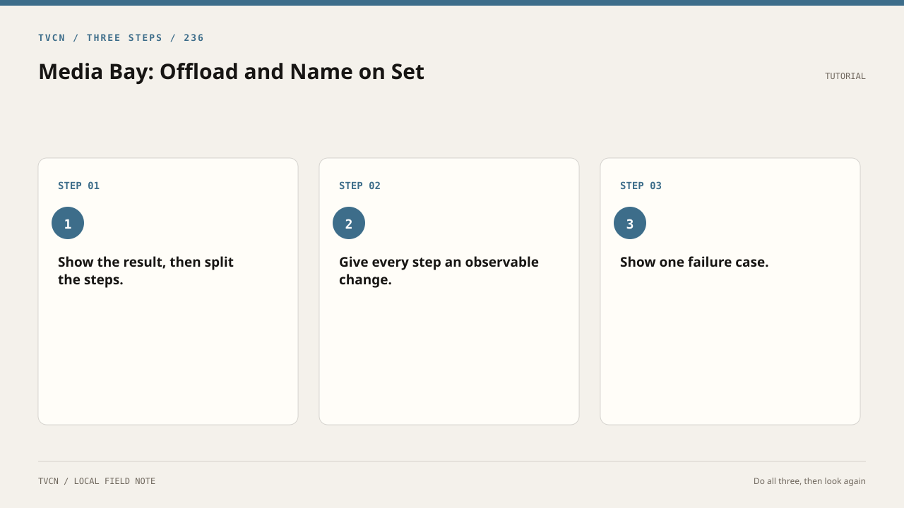

Offload, verify, name, and back up on set; organizing later doubles the time.

<!-- DIAGRAM_START -->
<h2>Diagram</h2>
<figure>
  
  <figcaption>Do the three steps in order, then look again at the image or file.</figcaption>
</figure>
<!-- DIAGRAM_END -->
<h2>On set</h2>

Set up one table with a reader, SSD, laptop, and labels. Copy, verify the checksum, then name the files.

<h2>Do this</h2>

The media bay copies, verifies, names, and backs up on set; sorting later doubles the time.
<ol><li>Set a table with card reader, SSD, laptop, and labels.</li><li>Verify checksum after copying.</li><li>Name by scene and shot.</li></ol>
<h2>Avoid</h2>

Do not take cards back to the studio to sort; unnamed on-set media doubles post time.

<h2>Check</h2>
<ul><li>An on-set table has reader, SSD, laptop, and labels.</li><li>Every card copy gets a checksum verification.</li><li>Media is named by scene and shot and needs no later sorting.</li></ul>
