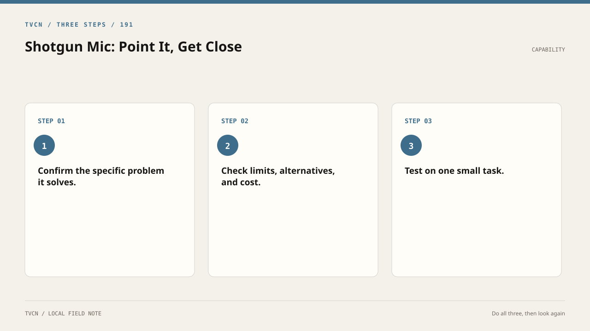

In hard-wall rooms, seated groups or when the mic must be hidden, a lav beats a shotgun. Do not use one shotgun for every scene.

<!-- DIAGRAM_START -->
<h2>Diagram</h2>
<figure>
  
  <figcaption>Watch “Record one line at one, two, and three” and “Play back for directionality and ambience ratio.”; judge whether the spec maps to one concrete shooting problem.</figcaption>
</figure>
<!-- DIAGRAM_END -->
<section><h2 id="section-1">What to compare first</h2><ul><li><strong>Pattern and off-axis:</strong> check pickup angle and off-axis rejection; too narrow misses movement, too wide collects the room.</li><li><strong>Power and output:</strong> confirm phantom power, battery and output level; camera input gain may not be enough.</li><li><strong>Wind protection and boom:</strong> a shotgun needs a blimp, furry cover and shock mount; without isolation, handling noise enters every line.</li></ul><h2 id="section-2">When not to use it</h2></section><section><h2 id="section-3">On set</h2>
Record the same line at one, two, and three meters. Check the directionality on playback; past two meters, switch to a lav or boom.
</section><section><h2 id="section-4">Do this</h2>
A shotgun is a directional tool; far away it only captures ambience. Move closer before discussing noise reduction.
<ol><li>Record one line at one, two, and three meters.</li><li>Play back for directionality and ambience ratio.</li><li>Beyond two meters, switch to a lav or boom.</li></ol></section><section><h2 id="section-5">Avoid</h2>
Do not rescue a distant shotgun with noise reduction; dialogue is already buried in ambience.
</section>
<h2>Check</h2><ul><li>One line is recorded at one, two, and three meters.</li><li>Playback reveals dialogue buried past two meters.</li><li>Shots beyond two meters have a lav or boom alternative.</li></ul>
