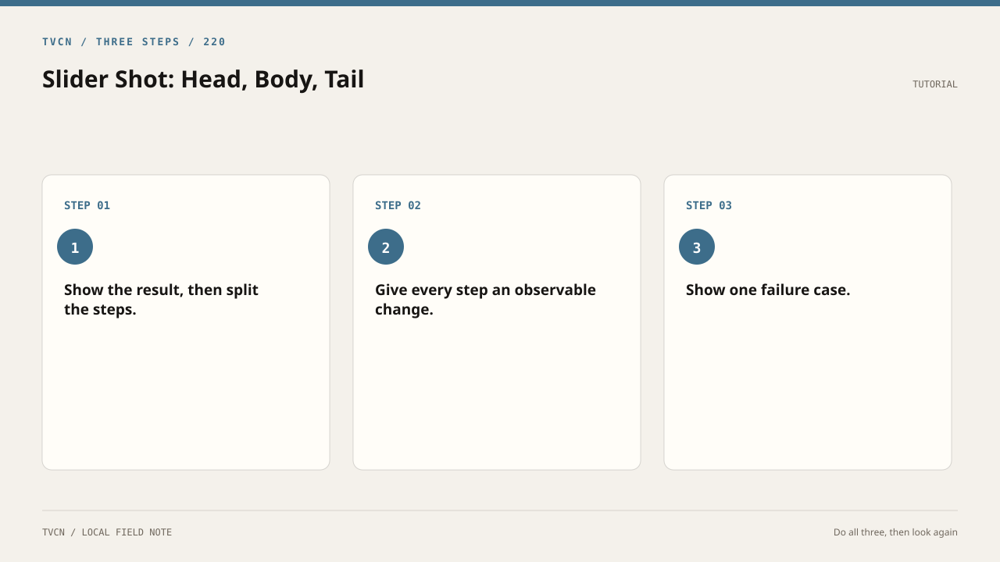

Ask what relationship the move reveals: foreground blocking giving way to a face, one person&#x27;s back to another&#x27;s face, an empty chair to a doorway. Without a change in relationship, the move is decoration.

<!-- DIAGRAM_START -->
<h2>Diagram</h2>
<figure>
  
  <figcaption>Watch “Hold one second at the start.” and “Travel evenly for three seconds.”; judge whether the spec maps to one concrete shooting problem.</figcaption>
</figure>
<!-- DIAGRAM_END -->
<section><h2 id="section-1">A slider is a relationship shot, not a flourish</h2>
Ask what relationship the move reveals: foreground blocking giving way to a face, one person's back to another's face, an empty chair to a doorway. Without a change in relationship, the move is decoration.

Keep the travel 20–40 cm and slow enough to read the background; both start and end must compose on their own.
<h2 id="section-2">Limits</h2>
A slider is wrong for fast action and tight spaces. Uneven floors and cables cause shake; clear the path before laying track.
<h2 id="section-3">Slider start and stop: three frames of ease at each end</h2>

A slider looks fake when it starts and stops abruptly. For a manual move, ease in and out over three frames; for a motor, set start/stop to 10–20% of travel.

<ol><li>Rehearse once and mark start and end. Do not look for the position after rolling.</li><li>Match speed to shot length: one meter in three seconds is about 0.33m/s. Faster blurs, slower drags.</li><li>Level the track with two boards on uneven ground; a tilted track tilts the frame.</li></ol>

Acceptance: playback for a “clunk” at the ends. If it knocks, add ease; do not fix it with warp stabilization.
</section><section><h2 id="section-4">On set</h2>
Hold one second at the start, move evenly for three, and hold one at the end. Watch the start and stop on the monitor; do not force it with the wrist.
</section><section><h2 id="section-5">Do this</h2>
A slider shot needs head, body, and tail: hold at the start, travel evenly, hold at the end.
<ol><li>Hold one second at the start.</li><li>Travel evenly for three seconds.</li><li>Hold one second at the end and watch the monitor, not your wrist.</li></ol></section><section><h2 id="section-6">Avoid</h2>
Do not push the moment you roll; without a start hold, the editor cannot find an in-point.
</section><section><h2>Judge</h2>
This page passes on three observable checks, not slogans:
<ul><li><strong>1.</strong> Start hold, three-second travel, and end hold are timecoded.</li><li><strong>2.</strong> The monitor shows no sudden acceleration or stop.</li><li><strong>3.</strong> Movement comes from the slider, not a forced wrist.</li></ul></section><section><h2>Failures</h2>
Any one of these means stop and fix it before post:
<ul><li><strong>1.</strong> Check 1 is only staged (“Start hold, three-second travel, and end hold…”); another camera position or location exposes it.</li><li><strong>2.</strong> Check 2 is left to post or a verbal explanation (“The monitor shows no sudden acceleration or st…”); nothing on set can be rechecked.</li><li><strong>3.</strong> Do not push the moment you roll; without a start hold, the editor cannot find an in-point.</li></ul></section><section><h2>Extend</h2>
<strong>10-minute exercise:</strong> Run a 60-second test with the gear you already own, measuring only “Hold one second at the start.”. Record two numbers: what you need and what the gear actually gives.
</section>
<h2>Check</h2><ul><li>Start hold, three-second travel, and end hold are timecoded.</li><li>The monitor shows no sudden acceleration or stop.</li><li>Movement comes from the slider, not a forced wrist.</li></ul>

> Intent split: this page covers the practical details of “Slider Shot: Head, Body, Tail”; start with <a href="https://shoot.tvcn.org/article/stabilizer/">Stabilizer: Walk Like You Mean It</a> for the cluster-level judgement, then return here.

<!-- INTENT_SCOPE -->

<!-- SOURCES_START -->
## Experience note

Experience note:This page draws on 4 production reviews under the listed software/camera versions and delivery platform; it covers the operating order for “Slider Shot: Head, Body, Tail”, not an external laboratory test, unlisted versions, cinema masters, broadcast safety certification or legal advice.
<!-- SOURCES_END -->

