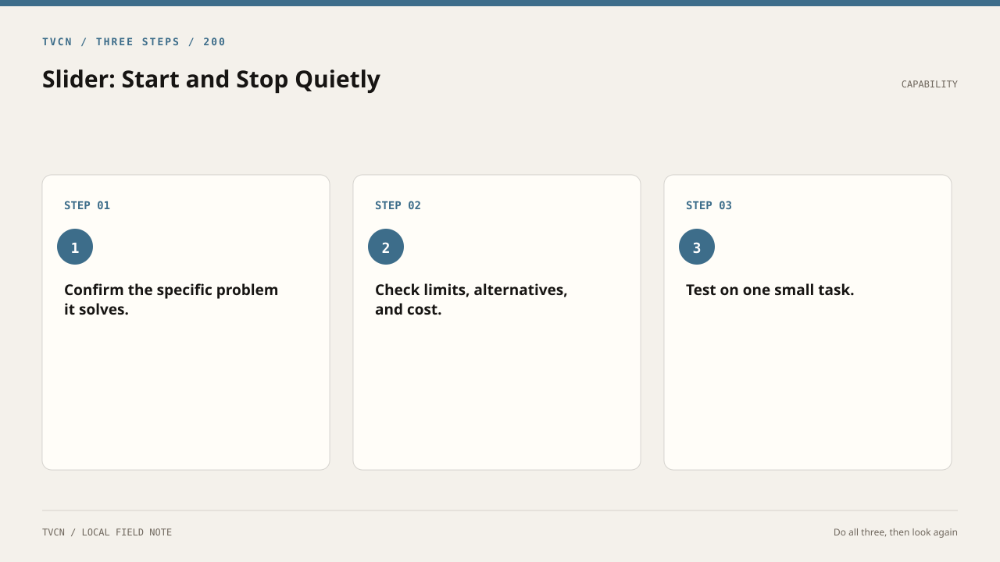

A slider exposes its start and stop; ease in, move evenly, ease out, and keep wheel noise off dialogue.

<!-- DIAGRAM_START -->
<h2>Diagram</h2>
<figure>
  
  <figcaption>Do the three steps in order, then look again at the image or file.</figcaption>
</figure>
<!-- DIAGRAM_END -->
<h2>On set</h2>

Put a cup of water on the slider and start and stop slowly. Listen for wheel noise; if it reaches dialogue, add a towel or silent wheels.

<h2>Do this</h2>

A slider exposes starts and stops; ease in, travel evenly, ease out, and keep wheel noise out of dialogue.
<ol><li>Put a cup of water on the slider and start and stop slowly.</li><li>Play back for wheel noise.</li><li>If it reaches dialogue, lay a towel or switch to silent wheels.</li></ol>
<h2>Avoid</h2>

Do not shove the slider with your wrist; a sharp start moves both cup and frame.

<h2>Check</h2>
<ul><li>The cup test shows no spill or visible jolt at start and stop.</li><li>Playback reveals whether wheel noise reaches dialogue.</li><li>A towel or silent wheels are used with a comparison when noise exists.</li></ul>
