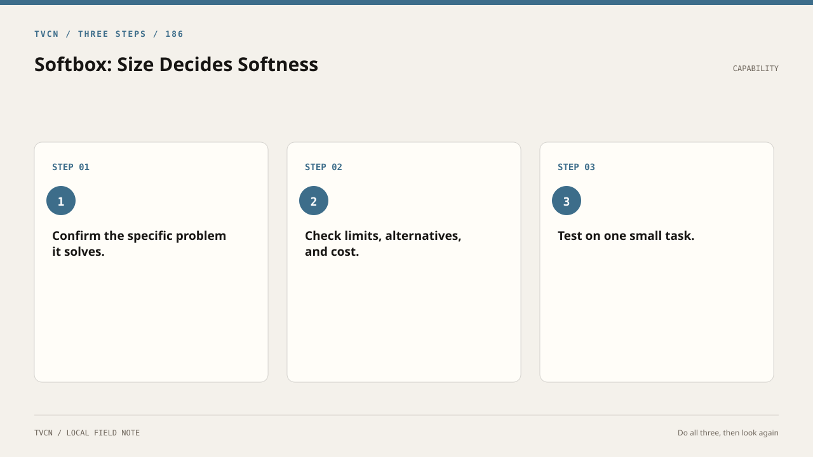

For hard light, defined shadows or long throws, a softbox scatters the direction. Do not use it for every lighting problem.

<!-- DIAGRAM_START -->
<h2>Diagram</h2>
<figure>
  
  <figcaption>Watch “Same light, softbox at 0.8 and 1.5 meters.” and “Shoot one frame at each distance.”; judge whether the spec maps to one concrete shooting problem.</figcaption>
</figure>
<!-- DIAGRAM_END -->
<section><h2 id="section-1">What to compare first</h2><ul><li><strong>Size:</strong> softness comes from area and distance, not brand; if a 120cm box will not fit, use a smaller one closer.</li><li><strong>Mount and structure:</strong> confirm mount, quick release, grid and diffusion; a box that is hard to build will be used less on set.</li><li><strong>Heat:</strong> a high-output COB in a small box traps heat; check vents and the fixture's cooling direction.</li></ul></section><section><h2 id="section-3">On set</h2>
With the same lamp, shoot at 0.8 and 1.5 meters. Compare the shadow edge and the size of the eye light.
</section><section><h2 id="section-4">Do this</h2>
The larger and closer the softbox, the softer the light; moving it closer beats changing the lamp.
<ol><li>Same light, softbox at 0.8 and 1.5 meters.</li><li>Shoot one frame at each distance.</li><li>Compare shadow edges and the size of the eye light.</li></ol></section><section><h2 id="section-5">Avoid</h2>
Do not buy a pricier lamp for softness; moving the softbox closer works more directly.
</section>
<h2>Check</h2><ul><li>0.8 m and 1.5 m samples use the same light.</li><li>The closer frame has visibly softer shadow edges.</li><li>Eye-light size changes with distance and is compared.</li></ul>

> Intent split: this page covers the practical details of “Softbox: Size Decides Softness”; start with <a href="https://tools.tvcn.org/article/buy-light-kit/">Buying a Light Kit: Soft Before Bright</a> for the cluster-level judgement, then return here.

<!-- INTENT_SCOPE -->

<section><h2>What this page does not solve</h2>
This page compares the capability and key parameters of “Softbox: Size Decides Softness”; it does not settle live pricing, warranty, mount/firmware compatibility or unit-to-unit sample variation for a specific model. Check the official spec sheet, a rental house test and the return terms. For shooting plans, budgets or on-set faults, use the matching method page first.
</section>
<!-- SOURCES_START -->
## Experience note

Experience note:This page draws on 7 gear trials and on-set playbacks under the listed model/firmware, once indoors and once outdoors; it covers the selection and use limits of “Softbox: Size Decides Softness”, not an external laboratory test, unlisted models, unit-level QC, warranty/rental contracts or safety certification.
<!-- SOURCES_END -->

