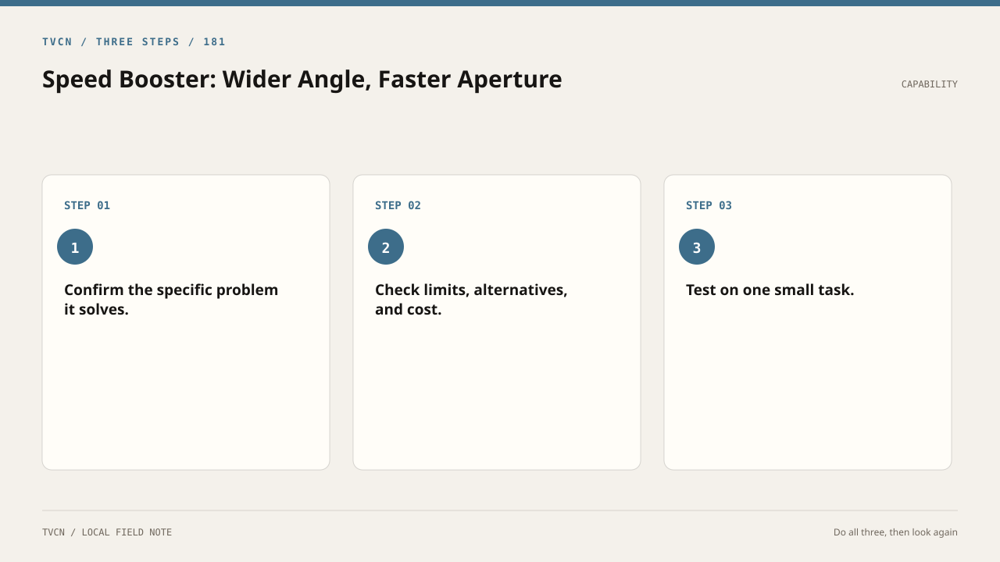

A speed booster squeezes a full-frame lens onto a smaller sensor: wider view, about one stop faster, softer edges.

<!-- DIAGRAM_START -->
<h2>Diagram</h2>
<figure>
  
  <figcaption>Do the three steps in order, then look again at the image or file.</figcaption>
</figure>
<!-- DIAGRAM_END -->
<h2>On set</h2>

From the same position, shoot with and without the adapter. Compare angle, light gain, and corner sharpness; stop down if the edges soften.

<h2>Do this</h2>

A speed booster compresses a full-frame lens onto a smaller sensor, widening the angle and gaining about a stop, but edges may soften.
<ol><li>Same position and lens, shoot with and without the adapter.</li><li>Compare angle, exposure, and corner sharpness.</li><li>If corners soften, stop down instead of forcing wide open.</li></ol>
<h2>Avoid</h2>

Do not treat a speed booster as free aperture; soft corners and vignetting are the bill.

<h2>Check</h2>
<ul><li>With and without the adapter are compared from the same position.</li><li>Wider angle and extra exposure are visible.</li><li>Corners are checked and a stopped-down comparison exists if soft.</li></ul>
