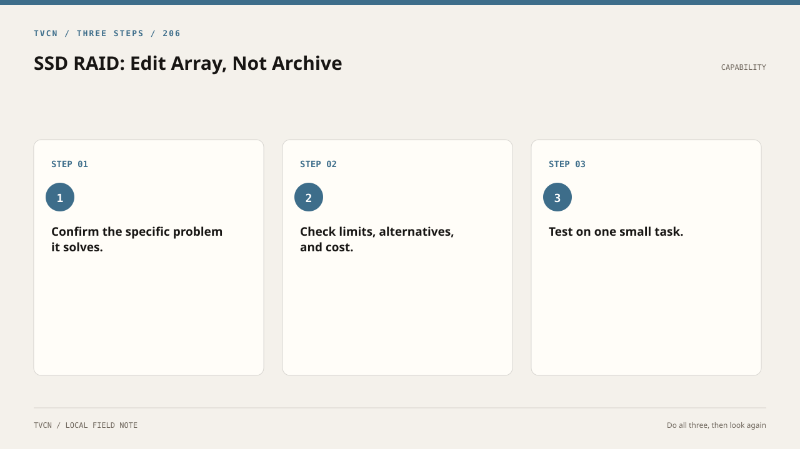

With one array and no offline backup, do not make it the only media library. RAID solves speed or a single-drive failure, not “the whole project disappeared.”

<!-- DIAGRAM_START -->
<h2>Diagram</h2>
<figure>
  
  <figcaption>Watch “Build RAID 0 for working media only.” and “Set RAID 1 or NAS for backup.”; judge whether the spec maps to one concrete shooting problem.</figcaption>
</figure>
<!-- DIAGRAM_END -->
<section><h2 id="section-1">Separate RAID from backup</h2><ul><li><strong>RAID 0:</strong> speed stacks, risk stacks; one drive failure can make the whole set unreadable. Use it only for regenerable cache.</li><li><strong>RAID 1/5/6:</strong> redundancy is still not backup; a controller failure, deletion or ransomware hits the whole array.</li><li><strong>Interface and cooling:</strong> confirm Thunderbolt/USB version, sustained write and cooling; a hot editing array throttles.</li></ul><h2 id="section-2">When not to use it</h2></section><section><h2 id="section-3">On set</h2>
Use RAID 0 only for working media and keep a RAID 1 or NAS as backup. Run a full-disk test and watch for slowdown.
</section><section><h2 id="section-4">Do this</h2>
SSD RAID is a editing work disk, not an archive; when the array dies, rebuilding costs more than backup.
<ol><li>Build RAID 0 for working media only.</li><li>Set RAID 1 or NAS for backup.</li><li>Fill the drive and measure the speed drop.</li></ol></section><section><h2 id="section-5">Avoid</h2>
Do not make RAID 0 the only storage; one drive failure takes all media.
</section><section><h2 id="section-6">Three causes</h2>
For “SSD RAID: Edit Array, Not Archive”, check three directions first. Change one variable, record a 30-second comparison, and see which link the change follows.

<table class="data-table"><thead><tr><th>Cause</th><th>Signal on set</th><th>Five-minute test</th></tr></thead><tbody><tr><td>RAID 0 as the only copy</td><td>One drive fails and all footage is gone</td><td>Use RAID 0 as a working disk, never as backup</td></tr><tr><td>Interface too slow</td><td>USB 10Gbps cannot feed a multi-drive array</td><td>Match host port and cable</td></tr><tr><td>Poor cooling</td><td>Sustained writes throttle and the edit stutters</td><td>Run a thirty-minute sustained write test</td></tr></tbody></table>
</section><section><h2 id="section-7">On-set diagnosis</h2><ol><li>Measure sustained read/write with AJA or Blackmagic, not peak burst only.</li><li>Write for thirty minutes and log speed, temperature and dropout.</li><li>Confirm an independent backup exists and a restore has been rehearsed.</li></ol></section><section><h2 id="section-8">Fix</h2>
RAID is an availability and speed tool, not a backup. Secure one independent copy before discussing an array.
<ol><li>Use a two-drive RAID 0 as the working disk and a separate drive/NAS as backup.</li><li>Use 10Gbps or faster; match cable and expansion card.</li><li>Leave cooling space around the array; do not stack drives.</li><li>Rehearse a restore monthly with a random file.</li></ol></section><section><h2 id="section-9">Failure cases</h2>
With “SSD RAID: Edit Array, Not Archive”, these three moves make it worse. Pick one replacement action and do not change three variables at once.

<table class="data-table"><thead><tr><th>Failure</th><th>Why it gets worse</th><th>Replace with</th></tr></thead><tbody><tr><td>Keep the only footage on RAID 0</td><td>One drive failure loses everything</td><td>Independent backup</td></tr><tr><td>Judge peak speed</td><td>Sustained writes drop and the edit stalls</td><td>Thirty-minute test</td></tr><tr><td>Use a USB hub</td><td>Bandwidth is shared and speed halves</td><td>Connect directly</td></tr></tbody></table>
</section><section><h2 id="section-10">Acceptance table</h2>
Acceptance is not “it feels better”; all four must be identifiable, playable and logged.

<table class="data-table"><thead><tr><th>Check</th><th>Pass line</th><th>Log</th></tr></thead><tbody><tr><td>Sustained write</td><td>Thirty minutes at twice the project bitrate</td><td>Speed log</td></tr><tr><td>Backup</td><td>At least one independent copy</td><td>Backup list</td></tr><tr><td>Restore</td><td>A random file restores</td><td>Drill log</td></tr><tr><td>Temperature</td><td>No thermal throttling under sustained write</td><td>Touch/sensor</td></tr></tbody></table>
</section><section><h2 id="section-11">One line for the set</h2>
RAID 0 is for speed; backup is for survival. They are not the same job.
</section>
<h2>Check</h2><ul><li>RAID 0 holds working media only and originals are backed up elsewhere.</li><li>A RAID 1 or NAS backup job runs.</li><li>A full-drive test logs the write-speed drop.</li></ul>
