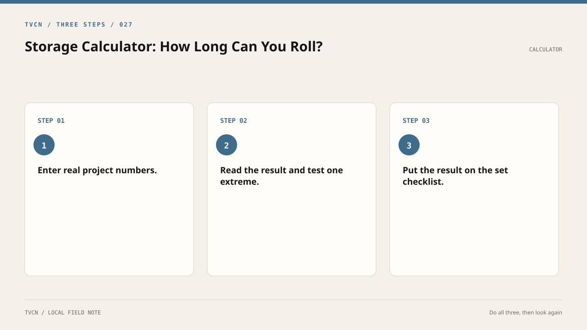

Calculate space from bitrate, duration, and copies; do not trust the camera's remaining-time guess.

<!-- DIAGRAM_START -->
<h2>Diagram</h2>
<figure>
  
  <figcaption>Do the three steps in order, then look again at the image or file.</figcaption>
</figure>
<!-- DIAGRAM_END -->
<h2>On set</h2>

4K at 100 Mbps is about 45 GB per hour. Add two backups and keep at least 20 percent free on the card.

<h2>Do this</h2>

A storage calculator uses bitrate, duration, and backup copies; do not trust the camera's remaining-time estimate.
<ol><li>4K at 100 Mbps is about 45 GB per hour.</li><li>Add two backups, so total times three.</li><li>Keep at least 20 percent headroom on the card.</li></ol>
<h2>Avoid</h2>

Do not trust camera remaining time; it assumes the current bitrate and breaks when the format changes.

<h2>Check</h2>
<ul><li>Bitrate, duration, and backup count use real values.</li><li>The total includes three copies and 20 percent headroom.</li><li>The result is written into the call sheet, not read off the camera.</li></ul>
