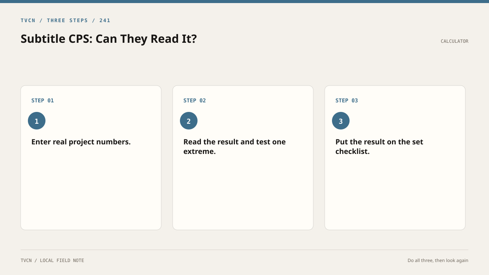

Check characters per second; above reading speed, the viewer pauses and the film breaks.

<!-- DIAGRAM_START -->
<h2>Diagram</h2>
<figure>
  
  <figcaption>Do the three steps in order, then look again at the image or file.</figcaption>
</figure>
<!-- DIAGRAM_END -->
<h2>On set</h2>

Keep Chinese under nine characters per second and English under fifteen. If over, split the line or hold longer.

<h2>Do this</h2>

A subtitle CPS calculator checks characters per second; beyond reading speed, viewers pause and the film breaks.
<ol><li>Chinese under nine characters per second, English under fifteen.</li><li>Split the sentence if over.</li><li>Or extend the duration; do not shrink it into two tiny lines.</li></ol>
<h2>Avoid</h2>

Do not shrink the font to fit; viewers cannot finish and will pause or quit.

<h2>Check</h2>
<ul><li>Every caption stays under nine Chinese characters or fifteen English characters per second.</li><li>Over-limit lines are split or extended, not shrunk.</li><li>At playback speed, each caption reads in one pass without pausing.</li></ul>
