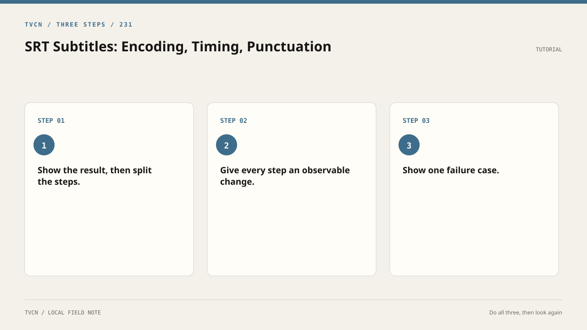

SRT subtitles protect UTF-8 encoding, timing, and punctuation; wrong encoding shows garbage on platforms.

<!-- DIAGRAM_START -->
<h2>Diagram</h2>
<figure>
  
  <figcaption>Watch “Save as UTF-8.” and “Time to the millisecond.”; judge whether the spec maps to one concrete shooting problem.</figcaption>
</figure>
<!-- DIAGRAM_END -->
<section><h2 id="section-1">On set</h2>
Save as UTF-8 with millisecond timing. Keep each subtitle under two lines and sixteen characters per line.
</section><section><h2 id="section-2">Do this</h2><ol><li>Save as UTF-8.</li><li>Time to the millisecond.</li><li>No more than two lines per caption, sixteen characters per line.</li></ol></section><section><h2 id="section-3">Avoid</h2>
Do not save Chinese SRT as ANSI; platforms show question marks.
</section><section><h2 id="section-4">Three causes</h2>
For “SRT Subtitles: Encoding, Timing, Punctuation”, check three directions first. Change one variable, record a 30-second comparison, and see which link the change follows.

<table class="data-table"><thead><tr><th>Cause</th><th>Signal on set</th><th>Five-minute test</th></tr></thead><tbody><tr><td>Wrong encoding</td><td>UTF-8 saved as GBK shows garbage on the platform</td><td>Export UTF-8 without BOM</td></tr><tr><td>Timeline drift</td><td>Wrong frame rate or start time makes later lines drift</td><td>Convert by frame rate and check in a player</td></tr><tr><td>Line length/punctuation</td><td>Long lines and mixed punctuation exhaust the reader</td><td>12–16 characters per line, two lines max</td></tr></tbody></table>
</section><section><h2 id="section-5">On-set diagnosis</h2><ol><li>Confirm UTF-8 in a text editor, not the system default.</li><li>Watch the whole file in the target player and note the first drift.</li><li>Measure the longest line; split anything over sixteen characters.</li></ol></section><section><h2 id="section-6">Fix</h2>
SRT is the simplest subtitle format and the easiest place to fail on encoding, frame rate and line length. Make it readable before translating it.
<ol><li>Use UTF-8 without BOM; do not save from Word.</li><li>Convert the timeline at the project frame rate and check first and last cues.</li><li>Keep 12–16 characters per line, two lines max; never break mid-word.</li><li>Use one punctuation system consistently, not a mix.</li></ol></section><section><h2 id="section-7">Failure cases</h2>
With “SRT Subtitles: Encoding, Timing, Punctuation”, these three moves make it worse. Pick one replacement action and do not change three variables at once.

<table class="data-table"><thead><tr><th>Failure</th><th>Why it gets worse</th><th>Replace with</th></tr></thead><tbody><tr><td>Ship machine translation</td><td>Word order and terms are wrong and the viewer cannot follow</td><td>Do at least one human pass</td></tr><tr><td>Fill one line</td><td>The viewer cannot finish reading and the subtitle covers the image</td><td>Split into two lines</td></tr><tr><td>Overlapping cues</td><td>Two subtitles appear at once</td><td>Check in/out times</td></tr></tbody></table>
</section><section><h2 id="section-8">Acceptance table</h2>
Acceptance is not “it feels better”; all four must be identifiable, playable and logged.

<table class="data-table"><thead><tr><th>Check</th><th>Pass line</th><th>Log</th></tr></thead><tbody><tr><td>Encoding</td><td>UTF-8 without BOM; no garbling</td><td>Text editor</td></tr><tr><td>Sync</td><td>First and last cue within one frame</td><td>Player check</td></tr><tr><td>Line length</td><td>No line over sixteen characters; two lines max</td><td>Longest-line count</td></tr><tr><td>Punctuation</td><td>One system throughout</td><td>Read-through</td></tr></tbody></table>
</section><aside class="regional-note">
<strong>Regional note for US / UK / EU readers</strong>

This English page keeps mainland-China examples where they are part of the method. Read platform names as examples, not as the only market: Douyin ↔ TikTok/Reels, Bilibili ↔ YouTube, Xiaohongshu ↔ Instagram/Pinterest; RMB figures are not converted here. Voltage, plug, warranty, import duty and radio certification differ by market; check the local spec sheet before ordering gear or batteries.
</aside><section><h2>Judge</h2>
This page passes on three observable checks, not slogans:
<ul><li><strong>1.</strong> The file is UTF-8 and Chinese renders correctly.</li><li><strong>2.</strong> Timing is to the millisecond with no overlaps.</li><li><strong>3.</strong> Captions stay within two lines of sixteen characters with punctuation.</li></ul></section><section><h2>Failures</h2>
Any one of these means stop and fix it before post:
<ul><li><strong>1.</strong> Check 1 is only staged (“The file is UTF-8 and Chinese renders correctl…”); another camera position or location exposes it.</li><li><strong>2.</strong> Check 2 is left to post or a verbal explanation (“Timing is to the millisecond with no overlaps”); nothing on set can be rechecked.</li><li><strong>3.</strong> Do not save Chinese SRT as ANSI; platforms show question marks.</li></ul></section><section><h2>Extend</h2>
<strong>10-minute exercise:</strong> Run a 60-second test with the gear you already own, measuring only “Save as UTF-8.”. Record two numbers: what you need and what the gear actually gives.
</section>
<h2>Check</h2><ul><li>The file is UTF-8 and Chinese renders correctly.</li><li>Timing is to the millisecond with no overlaps.</li><li>Captions stay within two lines of sixteen characters with punctuation.</li></ul>

<section><h2>Boundary</h2>
This page only covers “SRT Subtitles: Encoding, Timing, Punctuation”; it does not replace Multicam Sync: Timecode and Clap, Test Protocol Library: Ten Reproducible On-Set Tests, Composition: Tell the Eye Where to Look. When the problem belongs to one of those pages, use that page instead of adding more parameters here.
</section>
<!-- SOURCES_START -->
## References and further reading

- [S68] [W3C: WebVTT](https://www.w3.org/TR/webvtt1/) — Accessed 2026-11-26. Used to check the terminology/method/rule in the “On set” section against WebVTT caption format, not platform review rules; it does not verify numbers, model choices or on-set conclusions derived from this page, and is not a substitute for a test.
- [S29] [YouTube: Upload Encoding Specs](https://support.google.com/youtube/answer/1722171) — Accessed 2026-11-26. Used to check the terminology/method/rule in the “Do this” section against YouTube upload encoding recommendations, not creative standards; it does not verify numbers, model choices or on-set conclusions derived from this page, and is not a substitute for a test.
<!-- SOURCES_END -->

