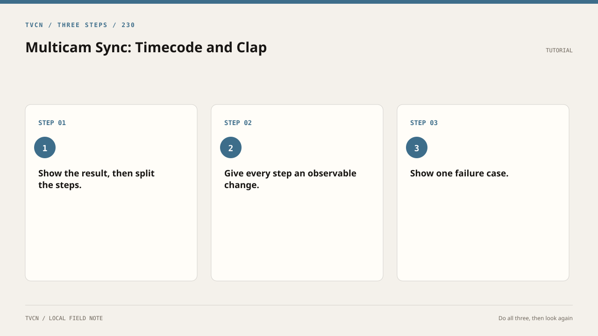

Sync timecode first, clap as backup; with both, the edit can cut confidently.

<!-- DIAGRAM_START -->
<h2>Diagram</h2>
<figure>
  
  <figcaption>Do the three steps in order, then look again at the image or file.</figcaption>
</figure>
<!-- DIAGRAM_END -->
<h2>On set</h2>

Sync timecode and clap once more. Build a multicam clip and switch using the camera map.

<h2>Do this</h2>

Multicam sync uses timecode first and a clap as backup; with both, the edit dares to cut.
<ol><li>Sync timecode, then clap once more.</li><li>Build a multicam clip in the edit.</li><li>Switch by the camera map, not memory.</li></ol>
<h2>Avoid</h2>

Do not rely on timecode alone; one camera off-code throws the whole multicam group.

<h2>Check</h2>
<ul><li>All cameras share timecode with a clap backup.</li><li>A multicam clip exists with the correct camera count.</li><li>Switching follows the camera map and every shot's source is nameable.</li></ul>
