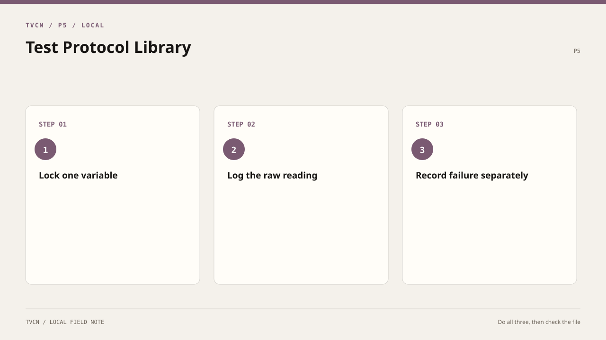

Reproducible steps, raw-data fields and pass lines for ten tests. Without gear, write “not measured”; do not invent numbers.

<!-- DIAGRAM_START -->
<h2>Diagram</h2>
<figure>
  
  <figcaption>The record structure: condition, reading, failure.</figcaption>
</figure>
<!-- DIAGRAM_END -->
<h2>How to use: say “not measured” when it is not measured</h2>

These ten protocols are for people with gear, not a lab score sheet. Each record includes machine, firmware, lens, software version, environment, method, raw data, failure condition and cost. Without gear, write public specs and steps, not numbers. “Not measured” is a boundary, not a flaw.
<ol><li>Change one variable at a time; lock everything else.</li><li>Shoot a baseline first, then the variable; at least two takes per condition.</li><li>Record failures, not only successes.</li><li>Never overwrite originals; name by date and condition.</li></ol>
<h2>Raw data sheet: one row per test</h2>

Download the CSV template and log row by row. Fields: date, test ID, machine/firmware, lens, software, room temperature, method, variable, raw reading, pass/fail, failure condition, file path. Leave a reading blank rather than writing “normal”.

<a href="../../assets/test-protocol-template.csv">Download the test log template (CSV)</a>

<h2>01 Rolling shutter / jelly</h2>

<strong>Purpose:</strong> Whether straight lines skew during a fast pan, and how read speed relates to shutter.

<table class="data-table"><thead><tr><th>Method</th><th>Raw log</th><th>Pass line</th></tr></thead><tbody><tr><td>Tripod, 24mm wide, pan left and right for two seconds; repeat at 1/50, 1/100 and 1/200 on the same vertical line.</td><td>Machine, firmware, lens, software, room temperature; record the failure condition.</td><td>At 1/50, lines remain acceptable and do not turn into a leaning tower.</td></tr></tbody></table>

Known failure: Reading the spec sheet only, with no pan. This page records the method; it does not print unmeasured data.

<h2>02 Low-light noise and dual native ISO</h2>

<strong>Purpose:</strong> Shadow noise, the dual-native ISO switch point, and whether skin stays usable.

<table class="data-table"><thead><tr><th>Method</th><th>Raw log</th><th>Pass line</th></tr></thead><tbody><tr><td>Fix aperture and shutter, step ISO from native to 3200 on a grey card and a face; disable denoise.</td><td>Machine, firmware, lens, software, room temperature; record the failure condition.</td><td>ISO 3200 skin is readable; shadows show no obvious blocking.</td></tr></tbody></table>

Known failure: Judging on a screen without logging ISO. This page records the method; it does not print unmeasured data.

<h2>03 Autofocus breathing and tracking</h2>

<strong>Purpose:</strong> Whether eye/object transitions hunt and whether low light still tracks.

<table class="data-table"><thead><tr><th>Method</th><th>Raw log</th><th>Pass line</th></tr></thead><tbody><tr><td>Walk a person from 1m to 3m and out of frame; repeat in low light and backlight.</td><td>Machine, firmware, lens, software, room temperature; record the failure condition.</td><td>Transitions do not hunt; low light still tracks.</td></tr></tbody></table>

Known failure: Shooting only static objects. This page records the method; it does not print unmeasured data.

<h2>04 Lens breathing and parfocal</h2>

<strong>Purpose:</strong> Whether focus shifts or the frame zooms during a zoom.

<table class="data-table"><thead><tr><th>Method</th><th>Raw log</th><th>Pass line</th></tr></thead><tbody><tr><td>Lock the camera, focus on a chart, zoom from wide to tele and back.</td><td>Machine, firmware, lens, software, room temperature; record the failure condition.</td><td>Focus remains acceptable through the zoom; no obvious scale change.</td></tr></tbody></table>

Known failure: Judging a single frame without zooming. This page records the method; it does not print unmeasured data.

<h2>05 Preamp noise and gain</h2>

<strong>Purpose:</strong> Recorder/mic preamp noise and gain structure.

<table class="data-table"><thead><tr><th>Method</th><th>Raw log</th><th>Pass line</th></tr></thead><tbody><tr><td>Record 30 seconds of room tone, normal speech and a close shout in a quiet room.</td><td>Machine, firmware, lens, software, room temperature; record the failure condition.</td><td>Normal speech peaks at -12dBFS; quiet gaps have no obvious hiss.</td></tr></tbody></table>

Known failure: Listening without soloing the track. This page records the method; it does not print unmeasured data.

<h2>06 ND colour cast</h2>

<strong>Purpose:</strong> Whether ND shifts colour, vignettes, or matches its marked stop.

<table class="data-table"><thead><tr><th>Method</th><th>Raw log</th><th>Pass line</th></tr></thead><tbody><tr><td>Shoot a white wall/grey card with and without ND at the same aperture; repeat at the wide end.</td><td>Machine, firmware, lens, software, room temperature; record the failure condition.</td><td>White wall stays neutral; corners do not darken noticeably.</td></tr></tbody></table>

Known failure: Trusting the filter marking without a white wall. This page records the method; it does not print unmeasured data.

<h2>07 Sustained card/SSD write and heat</h2>

<strong>Purpose:</strong> Whether sustained writes drop speed, overheat or disconnect.

<table class="data-table"><thead><tr><th>Method</th><th>Raw log</th><th>Pass line</th></tr></thead><tbody><tr><td>Write for thirty minutes at twice the project bitrate; log speed and temperature.</td><td>Machine, firmware, lens, software, room temperature; record the failure condition.</td><td>Thirty minutes at twice the project bitrate.</td></tr></tbody></table>

Known failure: Measuring a ten-second peak only. This page records the method; it does not print unmeasured data.

<h2>08 Monitor brightness and latency</h2>

<strong>Purpose:</strong> Whether brightness, colour and latency suit focus and grading.

<table class="data-table"><thead><tr><th>Method</th><th>Raw log</th><th>Pass line</th></tr></thead><tbody><tr><td>Feed the same signal to monitor and computer; clap for latency; check brightness under a hood.</td><td>Machine, firmware, lens, software, room temperature; record the failure condition.</td><td>Latency within one frame; brightness and colour can be calibrated.</td></tr></tbody></table>

Known failure: Reading specs without a side-by-side. This page records the method; it does not print unmeasured data.

<h2>09 Gimbal follow and rebound</h2>

<strong>Purpose:</strong> Whether follow mode lags, rebounds, or stays stable while walking.

<table class="data-table"><thead><tr><th>Method</th><th>Raw log</th><th>Pass line</th></tr></thead><tbody><tr><td>Balance, walk a 10m line, orbit a person and climb stairs; three takes each.</td><td>Machine, firmware, lens, software, room temperature; record the failure condition.</td><td>No obvious rebound on a 10m line; stairs do not hit a limit.</td></tr></tbody></table>

Known failure: Spinning in place without walking. This page records the method; it does not print unmeasured data.

<h2>10 Export time and hardware bottleneck</h2>

<strong>Purpose:</strong> Export time, GPU/CPU/disk bottleneck, and failure conditions.

<table class="data-table"><thead><tr><th>Method</th><th>Raw log</th><th>Pass line</th></tr></thead><tbody><tr><td>Export the same 4K 10-bit timeline to H.264 and ProRes; log time and utilisation.</td><td>Machine, firmware, lens, software, room temperature; record the failure condition.</td><td>Export completes and time is reproducible; one benchmark is not a conclusion.</td></tr></tbody></table>

Known failure: One export with no environment log. This page records the method; it does not print unmeasured data.

<!-- P5_EXTRA_START -->
<h2>Add: how to write one row</h2>

Example: 2026-11-23; test RS-01; body A7S3 / firmware 2.0; lens 24mm; software NLE 1.0; room 22°C; method “2-second pan, 1/50”; variable “shutter 1/100”; raw reading “line bends 18px”; result “fail”; failure condition “fast pan”; path “/tests/RS-01.mp4”. Leave a cell blank rather than writing “normal”.

<h2>Add: log failure conditions separately</h2>

Failure is not “it looked bad”; it is a reproducible condition: which body, firmware, lens, temperature, card and setting. If the failure condition is vague, the test cannot be reproduced or used for a buying decision.
<ol><li>Write the pass line first, then the failure point.</li><li>Someone else must be able to reproduce it with the same steps.</li><li>Keep failure files separately; never overwrite.</li></ol>

<!-- SOURCES_START -->
## References and further reading

- [S23] [SMPTE: Standards](https://www.smpte.org/standards) — Accessed 2026-11-26. Used to check the terminology/method/rule in the “How to use: say “not measured” when it is not measured” section against SMPTE standards portal, not specific camera specs; it does not verify numbers, model choices or on-set conclusions derived from this page, and is not a substitute for a test.
- [S31] [ARRI: Cine Systems](https://www.arri.com/en/cine-systems) — Accessed 2026-11-26. Used to check the terminology/method/rule in the “02 Low-light noise and dual native ISO” section against ARRI camera, lens and lighting documentation, not a general shooting tutorial; it does not verify numbers, model choices or on-set conclusions derived from this page, and is not a substitute for a test.
<!-- SOURCES_END -->

