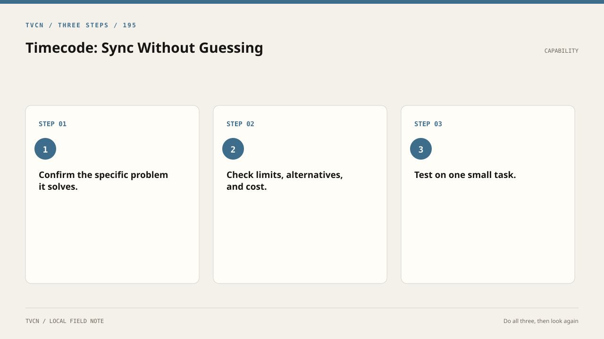

Timecode syncs cameras and recorders in the first minute of post; without it, sync is luck.

<!-- DIAGRAM_START -->
<h2>Diagram</h2>
<figure>
  
  <figcaption>Do the three steps in order, then look again at the image or file.</figcaption>
</figure>
<!-- DIAGRAM_END -->
<h2>On set</h2>

Jam the recorder and camera to the same timecode and shoot ten seconds. Sync in post and check for less than one frame of drift.

<h2>Do this</h2>

Timecode aligns multicamera and recorder in the first minute of post; without it, syncing is luck.
<ol><li>Jam the recorder and camera to the same timecode.</li><li>Shoot a ten-second test.</li><li>Sync in post and check drift under one frame.</li></ol>
<h2>Avoid</h2>

Do not jam once and shoot all day; drift shows up in the afternoon.

<h2>Check</h2>
<ul><li>Recorder and camera display the same timecode.</li><li>The ten-second test syncs under one frame in post.</li><li>A second jam is logged mid-shoot, not only one at the start.</li></ul>
