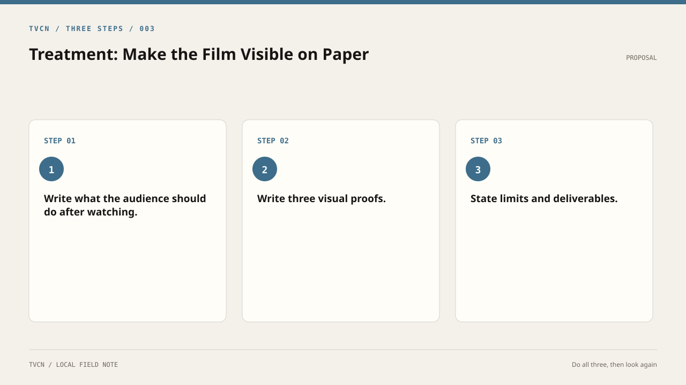

A treatment does not decorate a script; it lets the client see the film's shape, tone, and limits before the shoot.

<!-- DIAGRAM_START -->
<h2>Diagram</h2>
<figure>
  
  <figcaption>Do the three steps in order, then look again at the image or file.</figcaption>
</figure>
<!-- DIAGRAM_END -->
<h2>On set</h2>

Use twelve pages: one sentence, three reference frames, the shooting plan, and delivery limits. One idea per page so the client can see the film.

<h2>Do this</h2>

A treatment is not a script rewritten in fancy words; it lets the client see the film's look, tone, and boundary before the shoot.
<ol><li>Use twelve pages: one sentence, three reference frames, shooting plan, delivery boundary.</li><li>One idea per page.</li><li>By the last page the client can say what the film looks like, what is delivered, and what is excluded.</li></ol>
<h2>Avoid</h2>

Do not use “premium, cinematic” as the plan; the client cannot see those words.

<h2>Check</h2>
<ul><li>Each of twelve pages carries one topic without text piles.</li><li>Three reference frames show look and tone.</li><li>The client can repeat deliverables, dates, price, and exclusions.</li></ul>
