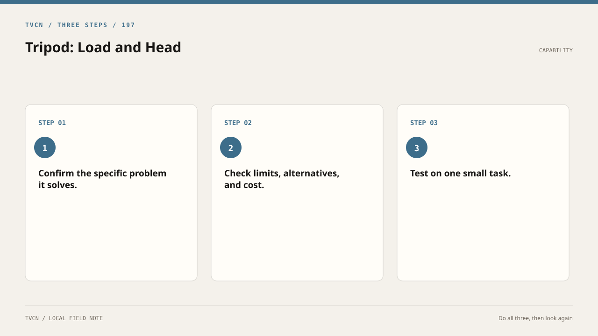

Check payload and head before max height; camera, lens, and accessories weigh more than the spec.

<!-- DIAGRAM_START -->
<h2>Diagram</h2>
<figure>
  
  <figcaption>Do the three steps in order, then look again at the image or file.</figcaption>
</figure>
<!-- DIAGRAM_END -->
<h2>On set</h2>

Mount the body, lens, monitor, and battery and lock the head. Push it three times and check the legs and head for spring.

<h2>Do this</h2>

A tripod is judged by payload and head, not maximum height; body, lens, and accessories usually weigh more than the rating.
<ol><li>Mount body, lens, monitor, and batteries.</li><li>Lock the head and push three times.</li><li>Check whether legs and head rebound.</li></ol>
<h2>Avoid</h2>

Do not size the tripod to a bare body; with lens and batteries the payload may already be over.

<h2>Check</h2>
<ul><li>Full rig weight is measured against the tripod rating.</li><li>Three pushes with the head locked show no leg slip or rebound.</li><li>Maximum height is not the main reason to buy; stability comes first.</li></ul>
