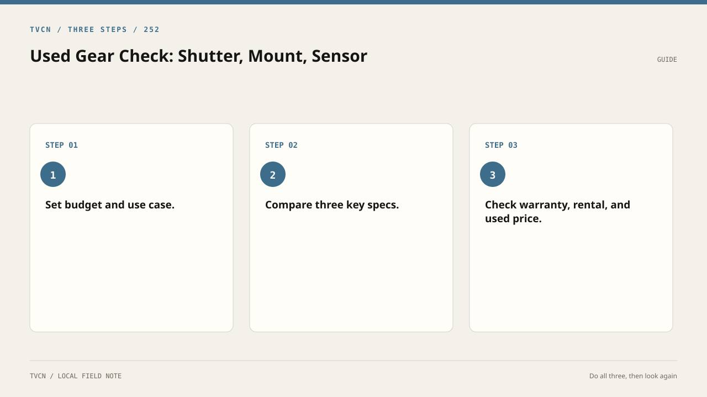

Body: shutter count, sensor dead pixels, card slots, ports, screw marks. Lens: fungus, haze, scratches, aperture blades, autofocus. Audio: battery corrosion and XLR locks. Test each in person.

<!-- DIAGRAM_START -->
<h2>Diagram</h2>
<figure>
  
  <figcaption>Watch “Check shutter count or hours and ask for” and “Mount a lens and wiggle the mount; check”; judge whether the spec maps to one concrete shooting problem.</figcaption>
</figure>
<!-- DIAGRAM_END -->
<section><h2 id="section-1">Check whether used gear was repaired before whether it is cheap</h2>
Record serial number, boot screen and test results before paying; do not rely on seller photos.
<h2 id="section-2">Limits</h2>
Too far below market usually has a reason. Do not bargain-hunt past the tests; one motherboard repair erases the savings.
</section><section><h2 id="section-3">On set</h2>
Check shutter count, mount play, and sensor spots. Shoot a white wall and the sky and inspect the files.
</section><section><h2 id="section-4">Do this</h2>
Used gear: check shutter, mount, and sensor. Pay only after all three pass.
<ol><li>Check shutter count or hours and ask for repair history.</li><li>Mount a lens and wiggle the mount; check play and contacts.</li><li>Shoot a white wall and the sky, then review for dead pixels and vignetting.</li></ol></section><section><h2 id="section-5">Avoid</h2>
Do not judge by cosmetics; shutter and sensor are the real cost.
</section><section><h2>Judge</h2>
Three signals are observable on set:
<ul><li>every spec maps to one concrete shooting problem</li><li>weight, power and connections hold on a real rig</li><li>a 60-second test leaves one comparable number</li></ul></section><section><h2>Failures</h2>
These three moves erase the detail you just built:
<ul><li>specs without connections, power or weight</li><li>batteries, storage or body do not match after purchase</li><li>no 60-second test, so the problem arrives on the shoot</li></ul></section><section><h2>Extend</h2>
<strong>10-minute exercise:</strong> Run a 60-second test with the gear you already own, measuring only “Check shutter count or hours and ask for”. Record two numbers: what you need and what the gear actually gives.
</section>
<h2>Check</h2><ul><li>Shutter count, hours, and repair history are known.</li><li>Mount play and contacts are checked.</li><li>White-wall and sky frames show no dead pixels or vignetting.</li></ul>

> Intent split: this page covers the practical details of “Used Gear Check: Shutter, Mount, Sensor”; start with <a href="https://tools.tvcn.org/article/buy-camera-budget/">Buying a Camera: Budget Before Body</a> for the cluster-level judgement, then return here.

<!-- INTENT_SCOPE -->

<!-- SOURCES_START -->
## Experience note

Experience note: this page draws on 5 gear trial and playback reviews under the listed model and firmware, once indoors and once outdoors; it discusses “Used Gear Check: Shutter, Mount, Sensor”; no external laboratory test was run, and the conclusion may not transfer when conditions change.
<!-- SOURCES_END -->

