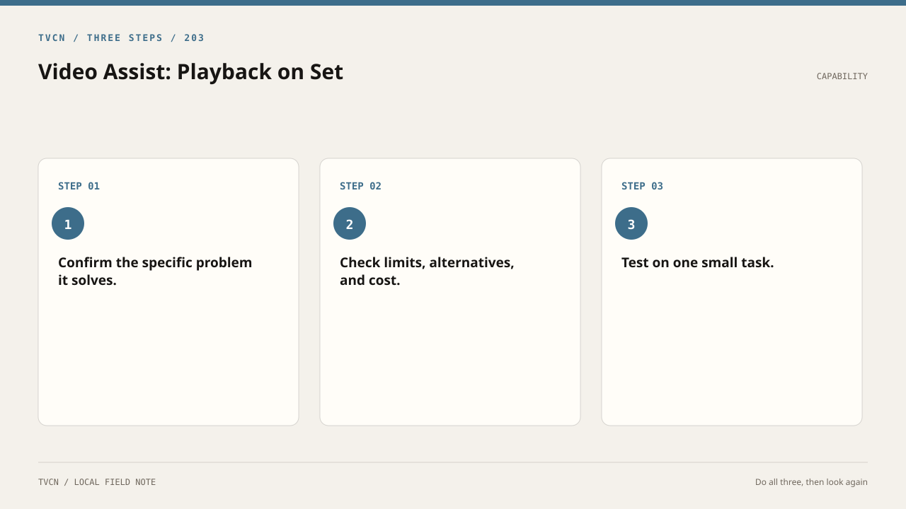

On a small crew with one camera and the director beside the monitor, a video assistant is an extra role; solve monitor position and communication first.

<!-- DIAGRAM_START -->
<h2>Diagram</h2>
<figure>
  
  <figcaption>Watch “Mark good, bad, scene, and shot for every” and “Back up the card.”; judge whether the spec maps to one concrete shooting problem.</figcaption>
</figure>
<!-- DIAGRAM_END -->
<section><h2 id="section-1">What to compare first</h2><ul><li><strong>Latency and playback:</strong> confirm camera-to-monitor delay and instant playback; a three-second wait breaks the director's rhythm.</li><li><strong>LUT and recording:</strong> LUT support, clean feed and backup recording; a pretty image is not enough.</li><li><strong>Power and cable:</strong> long runs and strain relief; a loose connector is more common than a missing feature.</li></ul><h2 id="section-2">When not to use it</h2></section><section><h2 id="section-3">On set</h2>
Mark every take good or bad with scene and shot number, and back up the card so the director can replay without waiting.
</section><section><h2 id="section-4">Do this</h2>
Video assist handles playback, marking, and backup; when the director can see the last take immediately, the set moves faster.
<ol><li>Mark good, bad, scene, and shot for every take.</li><li>Back up the card.</li><li>Playback reaches the right take without waiting.</li></ol></section><section><h2 id="section-5">Avoid</h2>
Do not back up without marking; when the director asks for playback, the set waits while you search.
</section>
<h2>Check</h2><ul><li>Every take carries good/bad, scene, and shot marks.</li><li>Cards are backed up between takes with verification.</li><li>A requested take plays within thirty seconds.</li></ul>
