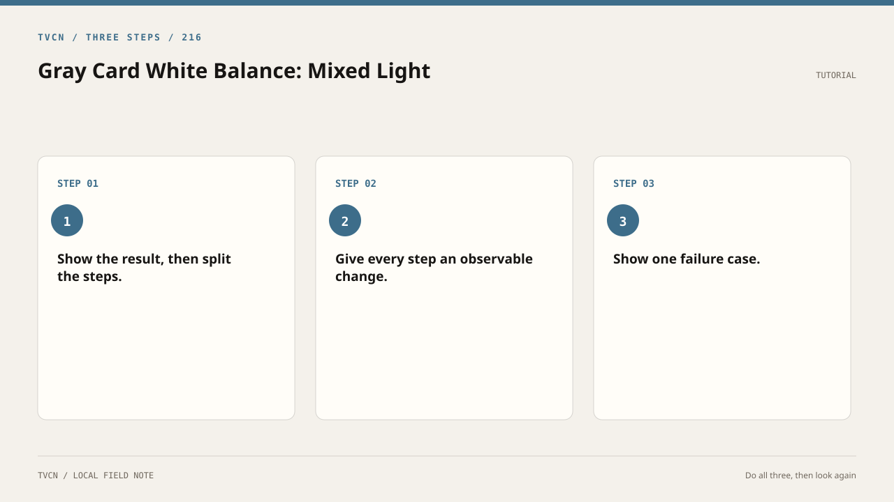

White balance is not clicking on sky or a white wall. Place the card at the face position, facing camera, in the same light as the subject. Under mixed light it represents one direction only.

<!-- DIAGRAM_START -->
<h2>Diagram</h2>
<figure>
  
  <figcaption>Watch “Place the gray card at the subject position” and “Set manual white balance and shoot.”; judge whether the spec maps to one concrete shooting problem.</figcaption>
</figure>
<!-- DIAGRAM_END -->
<section><h2 id="section-1">Put the gray card where the subject is lit</h2>
Shoot one per light position or color temperature; calibrate in post, then fine-tune skin.
<h2 id="section-2">Limits</h2>
A gray card cannot turn two temperatures into one. With cool window and warm lamp, decide which to keep, then unify with fill or gel.
</section><section><h2 id="section-3">On set</h2>
Place the grey card where the subject stands and let the light hit it. Set manual white balance, then shoot and check skin.
</section><section><h2 id="section-4">Do this</h2>
Gray-card white balance solves neutrality under mixed light; put the card where the subject stands, then read it.
<ol><li>Place the gray card at the subject position with light falling on it.</li><li>Set manual white balance and shoot.</li><li>Check skin for any cast.</li></ol></section><section><h2 id="section-5">Avoid</h2>
Do not balance under a lamp and then shoot by the window; position changes the mix.
</section><section><h2>Judge</h2>
Three signals are observable on set:
<ul><li>every spec maps to one concrete shooting problem</li><li>weight, power and connections hold on a real rig</li><li>a 60-second test leaves one comparable number</li></ul></section><section><h2>Failures</h2>
These three moves erase the detail you just built:
<ul><li>specs without connections, power or weight</li><li>batteries, storage or body do not match after purchase</li><li>no 60-second test, so the problem arrives on the shoot</li></ul></section><section><h2>Extend</h2>
<strong>10-minute exercise:</strong> Run a 60-second test with the gear you already own, measuring only “Place the gray card at the subject position”. Record two numbers: what you need and what the gear actually gives.
</section>
<h2>Check</h2><ul><li>The gray card sits at the subject position, not under the lamp.</li><li>A manual white-balance sample shows judgeable skin.</li><li>Mixed-light cast is removed or explicitly logged.</li></ul>
