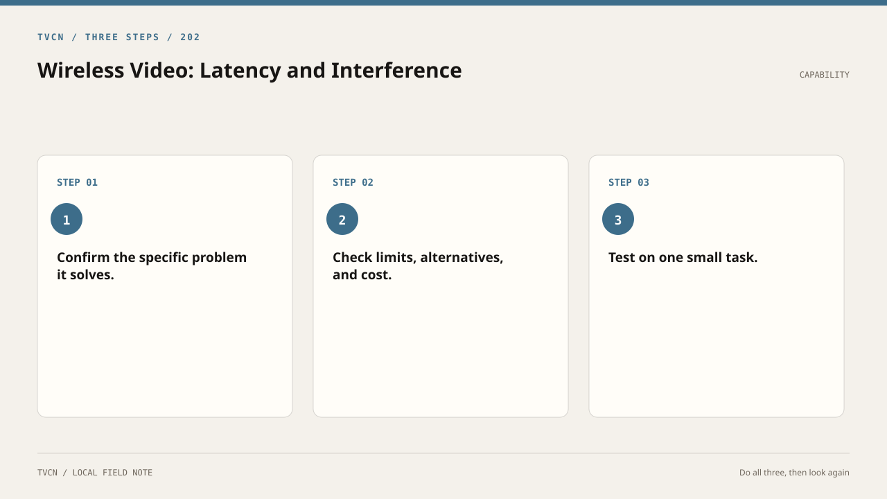

Test latency and interference before sending to director or focus puller; a dropped signal stops the set.

<!-- DIAGRAM_START -->
<h2>Diagram</h2>
<figure>
  
  <figcaption>Do the three steps in order, then look again at the image or file.</figcaption>
</figure>
<!-- DIAGRAM_END -->
<h2>On set</h2>

Walk the set and test latency and dropouts. Give the director and the focus puller separate signals; do not share one.

<h2>Do this</h2>

Wireless video needs latency and interference tests before deciding director or focus use; a dropout stops the set.
<ol><li>Walk the set and measure latency and dropouts.</li><li>Keep director and focus signals separate.</li><li>Log dropout spots and add antennas or change channels.</li></ol>
<h2>Avoid</h2>

Do not share one wireless link between director and focus; one dropout stops both.

<h2>Check</h2>
<ul><li>Latency and dropouts are logged across the set.</li><li>Director and focus monitoring use two separate links.</li><li>Dropout spots have a response, such as antennas or channel change.</li></ul>
