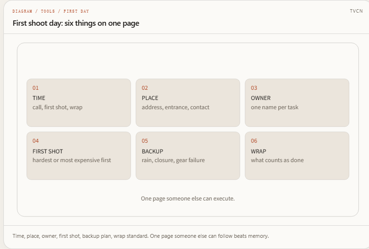

<!-- DIAGRAM_START -->
## Diagram

<figure>
  
  <figcaption>Time, place, owner, first shot, backup plan, wrap standard. One page someone else can follow beats memory.</figcaption>
</figure>
<!-- DIAGRAM_END -->

## A call sheet that fits on one page

A call sheet is not paperwork for the crew. It forces you to name what you are unsure about: call time, address, contact, lunch, parking, and the latest wrap time. Six lines will do. If you cannot write a street number, you have not scouted the location.

Photograph it, send it to the group, and ask everyone to reply “in.” Anyone who does not reply is assumed absent. Calling them on the day is usually too late.

## Shoot the light before the scene

Natural light will not wait. Shoot the window side, the backlight, and the dusk first; the sun moves every day. Dialogue you can pick up later goes in the afternoon. The sky you cannot recreate goes in the morning.

Order shots by light and by the actor’s condition, not by script page. New directors often shoot scene one through the end in order, then discover the best dusk light has ten minutes left.

## Give each department one concrete question

Camera: does this shot move? Sound: did we get room tone? Producer: when is lunch, and where do cars park? The director answers “what,” not every “how.”

Keep ten minutes before wrap: play back the last take, make one backup, confirm tomorrow’s call time. Skip those ten minutes and you will likely reshoot the next day.

## Three checks

- A driver can navigate to the address on the call sheet.
- The irreplaceable light is shot within two hours of rolling.
- Before wrap, the footage opens from a second drive.
