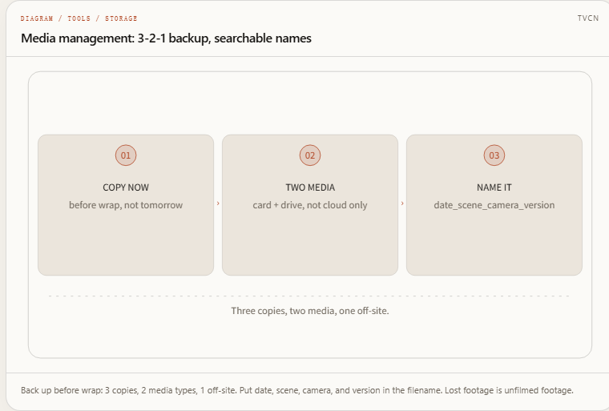

<!-- DIAGRAM_START -->
## Diagram

<figure>
  
  <figcaption>Back up before wrap: 3 copies, 2 media types, 1 off-site. Put date, scene, camera, and version in the filename. Lost footage is unfilmed footage.</figcaption>
</figure>
<!-- DIAGRAM_END -->

## The 3-2-1 rule

At least three copies: camera card, portable drive, another drive or cloud. Keep two in different places and one offline. Do it the same day, not after the edit.

Verify, do not just copy. Open a few files at random and confirm they play, have the right duration, and are not zero bytes.

## Naming rules

Use date_project_scene_camera_card: 20261120_coffee_S01_A_001. Do not use IMG_0001, and never name anything “final”.

Same day, same scene: S01, S02. Different cameras in one scene: A, B. Avoid spaces in names for cross-platform safety.

## Project archive

Archiving is not dumping footage into one folder. Use footage, audio, graphics, project, and export, plus a README explaining versions.

AI projects also store prompts, seeds, references, and generation logs. Otherwise you cannot reproduce or prove provenance three months later.

## Three checks

- Two independent copies exist the same day and play on spot check.
- Any shot can be found within a minute.
- AI projects keep prompts, seeds, and references.

<!-- DEEP_DIVE_START -->
## Deep dive

<strong>About 7 minutes.</strong> Storage is not buying one big drive. It is keeping the same material in three places and knowing which copy is newest.

### Three copies

One on the card, one on a portable drive, one on another drive or cloud. Do not carry all three in the same bag. Back up the day you shoot, not the day you edit.

Verify after copying: open three random files and play them, check sizes and file counts. A progress bar at 100% is not verification.

### A folder structure you can read

Sort by project, date, camera, scene. File names carry date and version; never “final” and “final2.” Keep camera original, proxies, exports, audio, and graphics separate.

Write a README: which folder is camera original, which is proxy, which is final export. You should still find it in three months.

### Calculate capacity

Calculate from bitrate: megabytes per minute equals bitrate times sixty divided by eight. Multiply by minutes, cameras, and copies. Leave twenty percent headroom.

Card speed matters too: sustained write below the codec drops frames. Do not trust peak numbers. Check the camera's recommended card list.

### Five-minute drill: one project storage sheet

Write a three-day project: minutes per day, cameras, bitrate, copies. Calculate total capacity and how many drives.

Show the sheet to your editor and ask if it is enough. If not, add a copy now; do not buy when the drive is full.

### When storage is safe

Storage is safe when three copies exist, verification playback passed, the folder structure is readable, headroom is over twenty percent, and old projects are archived. Five pass.

Two copies are not a backup; they are “not lost yet.” Add the third before editing.

### Check the third copy again

Unplug two drives and open the project from the third alone: can you find the originals, play them, rebuild the folder? The third copy is not “for later”; it is the one that can revive the project by itself right now.

### Ten storage checks
<ul><li>One copy on card</li><li>One on portable drive</li><li>Third off-site or cloud</li><li>Three copies not in one bag</li><li>Back up the day you shoot</li><li>Play three random files to verify</li><li>File names carry date and version</li><li>Originals, proxies, exports separate</li><li>Capacity from bitrate with twenty percent headroom</li><li>Sustained write speed sufficient</li></ul>
Storage safety does not come from drive size. It comes from being able to say where all three copies are.

<!-- DEEP_DIVE_END -->

<!-- SOURCES_START -->
## References and further reading

- [S29] [YouTube Upload Specs](https://support.google.com/youtube/answer/1722171) — Accessed 2026-11-26. Used to check the terminology and public context in the opening paragraph (“Back up before wrap. Put date, scene, and camera in the file”) against Recommended resolution, bitrate, frame rate and audio codec; not a substitute for an on-set test.
- [S70] [FFmpeg: Documentation](https://ffmpeg.org/documentation.html) — Accessed 2026-11-26. Used to check the terminology and public context in the opening paragraph (“Back up before wrap. Put date, scene, and camera in the file”) against Codec, muxing and filter documentation; not a substitute for an on-set test.
<!-- SOURCES_END -->

