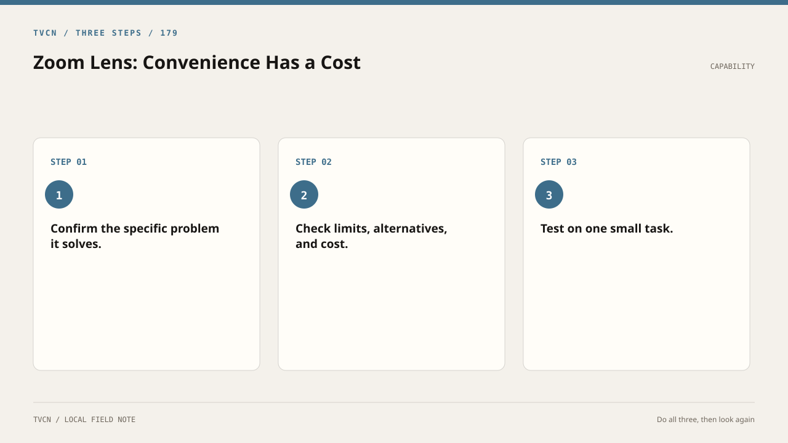

For extreme shallow depth, low light or minimum weight, a prime is better. Zoom convenience is not free.

<!-- DIAGRAM_START -->
<h2>Diagram</h2>
<figure>
  
  <figcaption>Watch “Take the camera to a shop and shoot” and “Check edges, distortion, and breathing.”; judge whether the spec maps to one concrete shooting problem.</figcaption>
</figure>
<!-- DIAGRAM_END -->
<section><h2 id="section-1">What to compare first</h2><ul><li><strong>Range:</strong> choose from your common camera-to-subject distance; 24-70 is not universal, and the long end may be tight indoors.</li><li><strong>Breathing and focus:</strong> does focus shift while zooming, and does the image breathe while focusing? Video is more sensitive than stills.</li><li><strong>Aperture and weight:</strong> constant fast apertures are heavier; calculate total weight and balance before a gimbal.</li></ul><h2 id="section-2">When not to use it</h2></section><section><h2 id="section-3">On set</h2>
Take the camera to the shop and shoot a backlit window and a railing wide open. Check edges, distortion, and breathing, then lift the lens.
</section><section><h2 id="section-4">Do this</h2>
A zoom saves time but charges you in weight, aperture, and image quality; ask which you lack most today.
<ol><li>Take the camera to a shop and shoot a backlit window and railing wide open.</li><li>Check edges, distortion, and breathing.</li><li>Weigh it and decide whether convenience is worth the price.</li></ol></section><section><h2 id="section-5">Avoid</h2>
Do not check center sharpness only; edges and backlight expose a zoom fastest.
</section>
<h2>Check</h2><ul><li>Wide-open backlit window and railing shots record edge performance.</li><li>Distortion and breathing are named, not just “good quality.”</li><li>Weight is measured and the saved step is stated.</li></ul>

> Intent split: this page covers the practical details of “Zoom Lens: Convenience Has a Cost”; start with <a href="https://tools.tvcn.org/article/buy-lens-first/">Buy the Lens First: Focal Length, Aperture, Breathing</a> for the cluster-level judgement, then return here.

<!-- INTENT_SCOPE -->

<!-- SOURCES_START -->
## Experience note

Experience note: this page draws on 6 gear trial and playback reviews under the listed model and firmware, once indoors and once outdoors; it discusses “Zoom Lens: Convenience Has a Cost”; no external laboratory test was run, and the conclusion may not transfer when conditions change.
<!-- SOURCES_END -->

