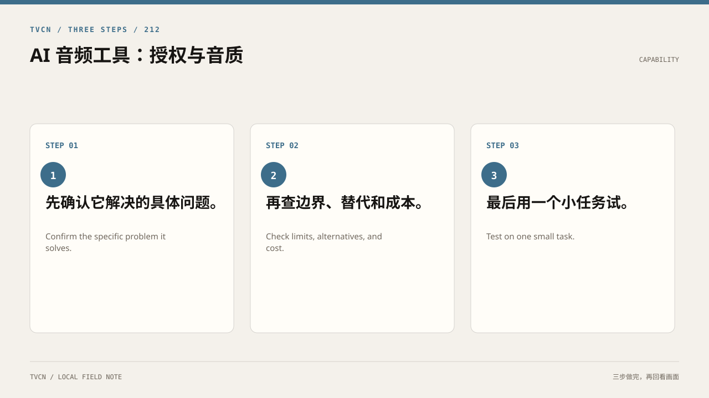

新闻、纪录片、证词和真实人物代言，不要用克隆声音替代原声。没有授权的声音，不进交付。

<!-- DIAGRAM_START -->
<h2>图解</h2>
<figure>
  
  <figcaption>看“让工具读一段 30 秒台词”和“听齿音、断句和尾音”两处，判断这个参数能不能对应到一个具体的拍摄问题。</figcaption>
</figure>
<!-- DIAGRAM_END -->
<section><h2 id="section-1">选型先看什么</h2><ul><li><strong>授权：</strong>商用许可、声音克隆范围和输出归属；不要只看“可商用”三个字，读完整条款。</li><li><strong>音质：</strong>试中文、英文、数字、人名和情绪句；只听 demo 不够，要用自己的稿子。</li><li><strong>可控性：</strong>能否导入自己的录音、控制停顿和重音；不能控的生成声，进不了对白剪辑。</li></ul><h2 id="section-2">什么时候不要用</h2></section><section><h2 id="section-3">现场</h2>
让工具读一段 30 秒台词，听齿音、断句和尾音；再查商用授权和克隆范围。
</section><section><h2 id="section-4">怎么做</h2><ol><li>让工具读一段 30 秒台词。</li><li>听齿音、断句和尾音。</li><li>再查商用授权和克隆范围。</li></ol></section><section><h2 id="section-5">别踩</h2>
别只听音色像不像；授权只限个人使用，商用一样不能用。
</section>
<h2>验收</h2><ul><li>30 秒台词里齿音、断句、尾音有评估。</li><li>商用授权和克隆范围有书面条款。</li><li>输出能用于当前项目，不需要额外授权。</li></ul>
