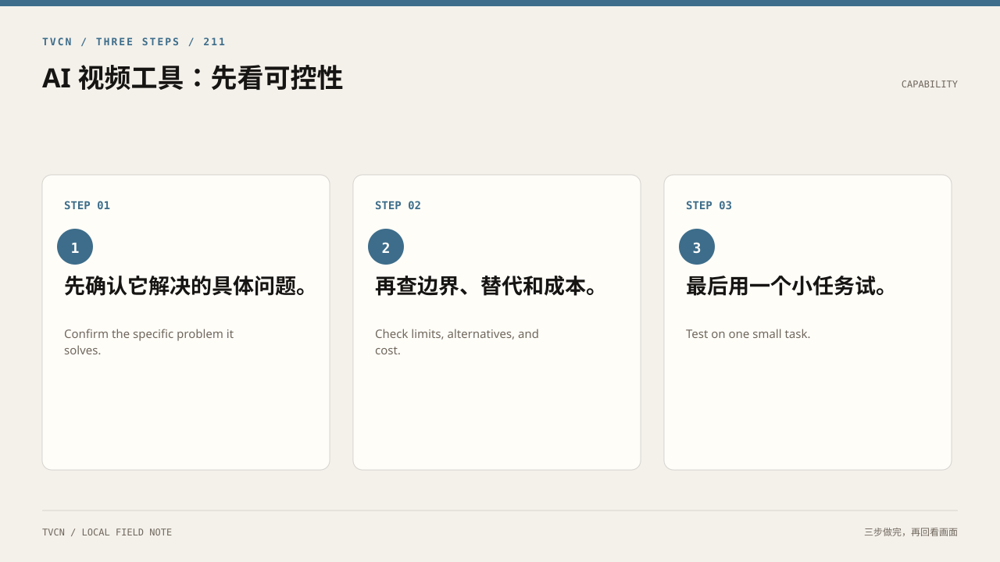

需要真实人物、新闻现场、精确对白或可追责素材时，生成工具不能替代实拍。没有授权链的镜头不进交付。

<!-- DIAGRAM_START -->
<h2>图解</h2>
<figure>
  
  <figcaption>看“用同一条提示测三样：角色是否一致、镜…”和“三项都过再付费”两处，判断这个参数能不能对应到一个具体的拍摄问题。</figcaption>
</figure>
<!-- DIAGRAM_END -->
<section><h2 id="section-1">先看可控性，不看演示</h2><ul><li><strong>镜头控制：</strong>能否指定景别、角度、焦段和运动；只能“再来一次”的工具不适合商单。</li><li><strong>一致性：</strong>角色、服装、光线和场景能否跨镜头保持；先测三镜头再批量。</li><li><strong>授权与输出：</strong>商用许可、输出分辨率、水印和元数据；不要等交片才发现限制。</li></ul><h2 id="section-2">什么时候不要用</h2></section><section><h2 id="section-3">现场</h2>
用同一条提示测三样：角色是否一致、镜头是否可控、时长是否够；三项都过再付费。
</section><section><h2 id="section-4">怎么做</h2><ol><li>用同一条提示测三样：角色是否一致、镜头是否可控、时长是否够。</li><li>三项都过再付费。</li><li>把失败案例一起存下来。</li></ol></section><section><h2 id="section-5">别踩</h2>
别被样片骗；样片只展示成功，不展示角色漂移。
</section>
<h2>验收</h2><ul><li>同一条提示下角色在三个镜头里保持一致。</li><li>镜头运动和时长能被具体参数控制。</li><li>失败案例有保存，知道边界在哪里。</li></ul>
