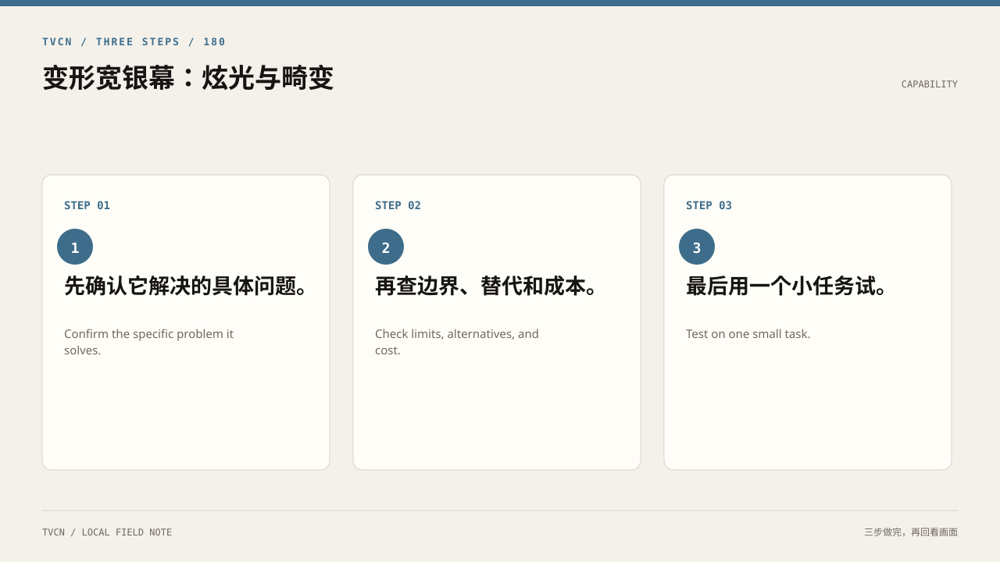

变形宽银幕不是把画面上下裁掉；它压缩横向、再还原，所以有椭圆光斑和独特畸变。

<!-- DIAGRAM_START -->
<h2>图解</h2>
<figure>
  
  <figcaption>把三步按顺序做完，再回看画面或文件。</figcaption>
</figure>
<!-- DIAGRAM_END -->
<h2>现场</h2>

拍一条夜景霓虹，看椭圆光斑和水平蓝线；再拍人脸，检查横向拉伸是否可接受。

<h2>怎么做</h2>

变形宽银幕不是把画面上下裁掉；它压缩横向、再还原，所以有椭圆光斑和独特畸变。
<ol><li>拍一条夜景霓虹，看椭圆光斑和水平蓝线。</li><li>再拍人脸，检查横向拉伸是否可接受。</li><li>把变形和裁切两个概念分开。</li></ol>
<h2>别踩</h2>

别把裁切当变形；没有椭圆光斑和横向压缩，它只是宽画幅。

<h2>验收</h2>
<ul><li>夜景霓虹里能看到椭圆光斑或水平蓝线。</li><li>人脸横向拉伸有样张，能判断是否可接受。</li><li>能说清变形与裁切的区别，不混为一谈。</li></ul>
