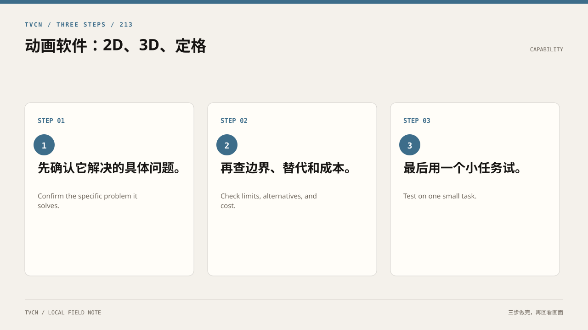

项目小、团队已熟练时，换软件的成本高于收益。先把现有管线的命名、版本和交接跑通。

<!-- DIAGRAM_START -->
<h2>图解</h2>
<figure>
  
  <figcaption>看“用同一段 5 秒动作，在 2D、3D…”和“看哪条流程最快出可看结果”两处，判断这个参数能不能对应到一个具体的拍摄问题。</figcaption>
</figure>
<!-- DIAGRAM_END -->
<section><h2 id="section-1">先按管线选，不按功能表选</h2><ul><li><strong>2D：</strong>要逐帧、绑定和合成时，选能处理图层与摄影机的工具；只看画笔功能会漏掉合成。</li><li><strong>3D：</strong>要建模、材质、灯光、渲染和缓存；确认资产交接和渲染器，不只看建模。</li><li><strong>定格：</strong>要能导入逐帧、做洋葱皮和对位；后期合成软件不能替代拍摄控制。</li></ul><h2 id="section-2">什么时候不要换软件</h2></section><section><h2 id="section-3">现场</h2>
用同一段 5 秒动作，在 2D、3D、定格各做一版测试；看哪条流程最快出可看结果。
</section><section><h2 id="section-4">怎么做</h2><ol><li>用同一段 5 秒动作，在 2D、3D、定格各做一版测试。</li><li>看哪条流程最快出可看结果。</li><li>按工序短板选，不按功能列表选。</li></ol></section><section><h2 id="section-5">别踩</h2>
别找一个全能软件；2D、3D、定格的工序根本不同。
</section>
<h2>验收</h2><ul><li>同一段 5 秒动作在三种流程里各有一版测试。</li><li>能指出哪条流程最快出可看结果。</li><li>选择依据是工序短板，不是功能数量。</li></ul>

<!-- SOURCES_START -->
## 经验说明

经验说明：本页来自 4 次器材试用与现场回放，条件为页面所列型号与固件、室内外各一次；页面讨论的具体对象是「动画软件：2D、3D、定格」；不含外部实验室测试，条件变化时结论可能失效。
<!-- SOURCES_END -->

